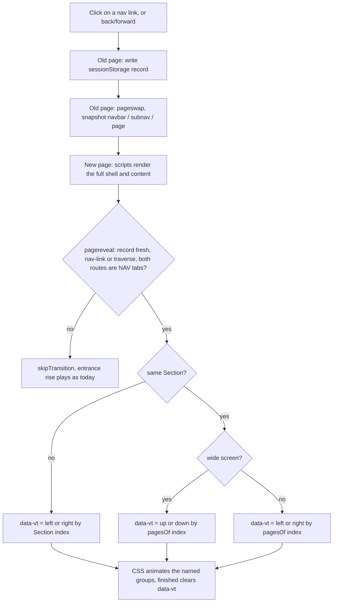

# Section sidebar, transparent cards and directional page transitions - Plan

## Goal Capsule

- **Objective:** Every section page reads as one calm surface: the sidebar and the cards share the page background, as on the home page and in the two reference screenshots. Moving between pages shows direction: sideways between Sections, up or down through Sub-tabs.
- **Means:** One branch with three commits: the home card treatment shared by all cards (KTD1, KTD2), the sidebar restyle with icons and Nested Sub-tabs (KTD3–KTD5), and cross-document View Transitions with a direction worked out from Section and Sub-tab order (KTD6–KTD9).
- **Authority:** This plan, then `GLOSSARY.md` for terms, then `docs/solutions/` (theme tokens only, literal layout requests, shared-asset checklist).
- **Stop conditions:**
  - Stop and report if a View Transition snapshot shows an empty or skeleton page on a real navigation.
  - Stop and report if any page gains horizontal scroll, a console error, or a visual-check finding.
  - Stop and report if a card's inner tint (selected row, callout, chip) vanishes in any theme.
- **Execution profile:** Plain JS and CSS in `docs/redesign/prototypes/assets/`, with no build step. Proof is browser runs: Playwright plus the visual check, not unit tests.
- **Finish and ship:** The executor opens one PR from `claude/sidebar-cards-transitions`. The user merges after "lets merge".

---

## Product Contract

### Summary

Shared cards (`.dcard`, `.kpi-tile`, `.card`) take the transparent home treatment everywhere. The section sidebar takes the page background, an icon per Sub-tab, and the Nested Sub-tabs that today sit in an underlined row in the page. Navigating by the top bar slides the page left or right. Navigating by the sidebar slides the content up or down.

### Problem Frame

The section pages show two surfaces: a white sidebar beside a beige page, and white card boxes on the beige page. The home page dropped the card boxes in commit 737bb17 and the user wants that everywhere. The references (OpenRouter, Fundamenta) have a sidebar on the page background with an icon per item. Navigation today is an instant cut, so the visitor gets no sense of moving across or down the structure.

### Requirements

**Cards**
- R1. Every `.dcard`, `.kpi-tile` and `.card` on every prototype page, at every width, has no background, no shadow and a transparent border. The border shows in `--card-edge` on hover or when keyboard focus is inside.
- R2. Inner surfaces that relied on the card being lighter than the page (selected rows, callouts, chips, zero cells, sticky table headers) stay visible in all five themes.
- R3. Overlays keep their surface: the info popover, menus, the date picker, the search dialog, the login card.

**Sidebar (wide screens, 1024 px and up)**
- R4. The section sidebar has the page background in every theme and keeps its right border line. The navbar does not change.
- R5. Each top-level Sub-tab shows one 16 px outline icon before its label (the list in KTD4). Labels stay uppercase and the "/ " marker stays.
- R6. A Sub-tab with Nested Sub-tabs lists them under itself, indented and without icons, only while the current page is inside that Sub-tab. The "/ " marks the current nested item, and the parent stays dark without a slash. Clicking the parent opens its first nested item.
- R7. On wide screens the underlined row of Nested Sub-tabs no longer shows in the page. Below 1024 px it stays as it is.

**Transitions**
- R8. Going to another Section from the top bar or the drawer slides the page in from the right when the target Section is to the right of the current one, and from the left otherwise. The navbar stays still.
- R9. Going to another Sub-tab on wide screens slides the content up into place when the target is lower in the sidebar, and down into place when it is higher. Nested Sub-tabs count in that order. The sidebar and the navbar stay still, and the "/ " glides to the new item.
- R10. Below 1024 px, Sub-tab and Nested Sub-tab changes slide left or right by the same order.
- R11. Browser back and forward between two Section or Sub-tab pages use the same direction rule.
- R12. Detail pages, links inside the content, and footer links keep today's behavior: no slide, and the entrance rise plays.
- R13. With reduced motion, R8–R11 become a crossfade with no movement. Browsers without cross-document View Transitions (Firefox) switch pages instantly, as now.

### Key Decisions

- **The home card treatment goes on all cards, phones included.** (session-settled: user-approved — chosen over home-only cards: one look across the site, and phones get no edge as on home.) Governs R1, R3.
- **The sidebar takes the page background; only icons are copied from the references.** (session-settled: user-directed — chosen over also adopting sentence-case labels, a filled current-item box and group labels: the user picked only the icons.) Governs R4, R5.
- **Nested Sub-tabs move into the sidebar and show only inside their parent.** (session-settled: user-directed — chosen over always-expanded lists: the sidebar stays short, and Αναλύσεις would otherwise list 11 items.) Governs R6, R7.
- **Slides follow structure order, not history.** (session-settled: user-approved — chosen over history-based direction: the same pair of pages always moves the same way.) Governs R8–R11.
- **Detail pages, in-content links and the footer get no slide.** (session-settled: user-approved — chosen over a generic slide: opening a story goes deeper, not sideways, so a slide would mislead.) Governs R12.
- **The slide is short: about 48 px plus a crossfade over about 250 ms.** (session-settled: user-approved — chosen over a full-width push: a full push on 1920 px shows an empty half page mid-move.) Governs R8–R10.

### Scope Boundaries

- The home page layout, the navbar, the footer and the phone drawer's look do not change.
- `.ecard`, `.toc`, `.owner-node`, `.mme-person` and other boxes that are not `.dcard`, `.kpi-tile` or `.card` keep their surface. R1 names the card classes, and these are content blocks inside cards or page furniture.
- The `#app:empty` loading skeleton keeps its raised blocks. A transition snapshot is taken after the scripts render, so the skeleton is not part of any slide.
- Considered and not built: a fallback slide for Firefox through a same-document API. The request is a page-to-page transition, and an instant switch is today's accepted behavior (R13).

#### Deferred to Follow-Up Work

- `scripts/make-icons.py` lists 12 names while `assets/icons.js` holds 17. U3 fixes the list because it regenerates the file. A check that the two cannot drift again is not part of this work.

---

## Planning Contract

### Key Technical Decisions

- KTD1. **The card rule moves from `home.css` into the base card declarations.** `.dcard` in `assets/dash.css`, `.kpi-tile` and `.card` in `assets/app.css` lose their background and take a transparent border with the hover/focus edge. Variants that repaint a card (`.minimal .dcard`, `.hero`, `.entity-grid .hero`) drop their background and shadow. `.entity-grid .hero` keeps its ink top line. The rule in `assets/home.css` from 737bb17 is removed, because the base now carries it. Base edits avoid a specificity fight with `.minimal .dcard`, which loads later in `dash.css`.
- KTD2. **A `--card-tint` token replaces `--surface-page` inside cards.** It is defined once in `assets/tokens.css` as `color-mix(in srgb, var(--ink) 6%, transparent)`, the value 737bb17 used for home rows, and it works in every theme. Each inner rule that paints `--surface-page` as a contrast against the card switches to it. Sticky table cells (`.mme-rank` thead, `.matrix tbody th`) switch from `--surface-raised` to `--surface-page`, because they must stay opaque over scrolled rows and the card is now the page color. Nested cards: an outer card that contains another card shows no hover edge, so one hover never draws two frames.
- KTD3. **The sidebar background is `--surface-page`, not a new token.** R4 is "same as the page" in every theme, so the page token states the intent directly. `--surface-sidebar` stays for the navbar and the drawer.
- KTD4. **Icons come from Heroicons 2.1.5 outline, generated into `assets/icons.js` by `scripts/make-icons.py`.** Map them in `assets/shell.js` by section and tab key, and render them with `UI.Icon` in the sidebar only. The same concept gets the same icon across sections:

| Section | Sub-tab | Icon |
|---|---|---|
| Μέσα | Επισκόπηση | `squares-2x2` |
| Μέσα | Ιδιοκτησία | `building-office-2` |
| Μέσα | Θέματα | `hashtag` |
| Μέσα | Πώς γράφουν | `pencil-square` |
| Μέσα | Ομοιότητα και πρωτοτυπία | `document-duplicate` |
| Ιστορίες | Επισκόπηση | `squares-2x2` |
| Ιστορίες | Ανά μέσο | `newspaper` |
| Ιστορίες | Υποθέσεις | `folder-open` |
| Ιστορίες | Μοτίβα διάδοσης | `share` |
| Πρόσωπα | Επισκόπηση | `squares-2x2` |
| Πρόσωπα | Έμφαση και στάση | `scale` |
| Πρόσωπα | Δηλώσεις | `chat-bubble-left-right` |
| Πρόσωπα | Φάκελος προσώπου | `identification` |
| Πολιτική | Προβολή | `eye` |
| Πολιτική | Μέσα | `newspaper` |
| Πολιτική | Ιδιοκτησία | `building-office-2` |
| Πολιτική | Θέματα | `hashtag` |
| Πολιτική | Συντάκτες | `pencil` |
| Αναλύσεις | Ομιλίες ΟΗΕ | `microphone` |
| Αναλύσεις | Παλαιστίνη–Ισραήλ | `globe-europe-africa` |
| Αναλύσεις | Ελληνοτουρκικά | `map` |
| Αναλύσεις | Μία είδηση, πολλές εκδοχές | `rectangle-stack` |
| Αναλύσεις | Γαλλία: ταραχές | `fire` |

- KTD5. **Nested Sub-tabs render from the existing `NAV` data.** The third item of a tab in `NAV` (`assets/shell.js`) already lists them. The sidebar renders them as a nested list under the parent when the parent is the current tab. The page-head `.sub-tabs` row is hidden at 1024 px and up. The row is still rendered so the phone keeps it (R7).
- KTD6. **Cross-document View Transitions, opted in for all pages in `assets/app.css`.** Every prototype page loads `app.css` and `shell.js`, which was checked with a grep over `*.html`. The pages run their scripts synchronously at the end of `<body>` and load their data as script files, so the first rendered frame, which is what the transition captures, is the full page.
- KTD7. **The direction is decided on the new page, in `pagereveal`, from a record the old page leaves behind.**
  1. The old page writes `{ from route, nav: true, target href, time }` to `sessionStorage` from a capture click listener on nav links: `.header-nav`, the drawer nav, `.section-nav`, `.section-tabs`, `.sub-tabs`. On `pageswap` it writes `{ from route, time }` and keeps a fresh click record's `nav` and `href` instead of overwriting them.
  2. The new page reads the record in `pagereveal`. The navigation counts when the record has `nav` and its `href` matches the new URL, or when the navigation is a traverse (back or forward). Traverse is detected from `navigation.activation.navigationType` where the browser has it, else from the navigation timing entry's type, else from a `persisted` page restore.
  3. When it counts, the new page maps both routes to a place (Section index, index in `pagesOf(item)`) and sets `data-vt` on `<html>`. Otherwise it calls `skipTransition()`. It clears the record either way.
  4. `data-vt` names where the target sits relative to the current page: `right` or `left` in Section order, `down` or `up` in Sub-tab order. The new content enters from that side.
  5. These skip the transition (R12): a record older than 5 s, a reload, the same route on both sides, a route outside `NAV` tabs (detail pages, footer), or a forward navigation that did not start on a nav link.

  A `data-vt` attribute is used instead of View Transition types because it is readable from plain CSS selectors and from a test. The `m-tab` record in `assets/motion.js` already uses `sessionStorage` with the same 5 s window.
- KTD8. **Three named groups, always named: `navbar` (`.header-bar`), `subnav` (`.section-nav`), `page` (`.page-main`).** Old and new snapshots then always pair up. The CSS picks the motion by `data-vt`:
  - `left`/`right` (a Section change): `subnav` and `page` slide and fade together, and `navbar` holds still.
  - `up`/`down` on wide screens: only `page` slides, and `subnav` shows the new state at once so the existing "/" glide in `motion.js`, extended to the vertical sidebar, stays visible.
  - Below 1024 px the sidebar is not displayed, so it is not captured, and `left`/`right` covers both cases (R10).

  The old and new images of `page` are pinned to the top with no stretch, so a taller or shorter page does not distort mid-slide. On `left`/`right` the size-and-position animation of the `page` and `subnav` groups is turned off, because Αρχική has no sidebar and its `page` starts at x = 0 while a section page starts after the 232 px sidebar. Without it the group would glide sideways on top of the slide. A `subnav` that exists on only one side (to or from Αρχική) slides out or in with the page.
- KTD9. **The entrance rise in `motion.js` does not run while `data-vt` is set.** The chart, bar and number first-view animations still run. `pagereveal` fires before the animation-frame callbacks of the first frame, where `intro()` runs. That ordering must be confirmed in U5 before relying on it.

### High-Level Technical Design

### Assumptions

- Chrome or Edge 126+ and Safari 18.2+ run cross-document View Transitions, and Firefox does not. That is the accepted fallback (R13).
- `pagereveal` fires on back and forward, including restores from the back/forward cache, so R11 needs no separate path. U5 verifies it.

---

## Implementation Units

### U1. Transparent cards everywhere

- **Goal:** All cards take the home treatment without losing any inner contrast.
- **Requirements:** R1, R2, R3. KTD1, KTD2.
- **Dependencies:** none.
- **Files:**
  - `docs/redesign/prototypes/assets/tokens.css`
  - `docs/redesign/prototypes/assets/app.css`
  - `docs/redesign/prototypes/assets/dash.css`
  - `docs/redesign/prototypes/assets/home.css`
  - `docs/redesign/prototypes/assets/mme.css`
  - `docs/redesign/prototypes/assets/world.css`
  - `docs/redesign/prototypes/assets/politics.css`
  - `docs/redesign/prototypes/assets/elections.css`
  - `?v=` bumps on every page that loads a changed asset
  - Verification script in the session scratchpad
- **Approach:**
  1. Add `--card-tint` in `tokens.css`.
  2. Change the base `.dcard`, `.kpi-tile` and `.card` declarations, then the `.minimal .dcard` and `.hero` variants (KTD1). Remove the 737bb17 card rule from `home.css` and point its row rules at `--card-tint`.
  3. Go through every `var(--surface-page)` in the CSS files above and switch to `--card-tint` the ones whose element sits inside a card. Leave page-level ones (`.dash-bar`, `.section-tabs`, the header, the search button) alone.
  4. Switch the two sticky cells to `--surface-page` (KTD2).
- **Patterns to follow:** the 737bb17 rule in `assets/home.css`, and `docs/solutions/conventions/theme-tokens-only.md`.
- **Test scenarios:**
  - `media-v2.html` at 1440 in `paper`: the computed background of every `.dcard` and `.kpi-tile` is transparent and the border color is transparent. Hovering one card gives that card's border the `--card-edge` color.
  - Tabbing to a link inside a card shows its edge (`:focus-within`).
  - `fingerprints-v2.html` (a `.minimal` page) and `france-v2.html` (a `.hero` card): no shadow and no raised background.
  - `world.css` and `politics.css` pages in `night` and `midnight`: a selected `.intent-table` row, a `.callout`, a `.pair-side` and a zero `.heat-cell` each have a computed background different from the page background.
  - `media-v2.html`: after scrolling the outlet ranking, the sticky table header is opaque and matches the page.
  - Opening the info popover, the date picker and the user menu: their backgrounds are still `--surface-raised`.
- **Verification:** All scenarios pass in `paper` and `night`. The visual check has no findings, and screenshots of a dash page, a `.minimal` page and a `world.css` page were looked at.

### U2. Sidebar background

- **Goal:** The section sidebar shares the page background.
- **Requirements:** R4. KTD3.
- **Dependencies:** none.
- **Files:** `docs/redesign/prototypes/assets/app.css`, `?v=` bumps.
- **Approach:** Change the `.section-nav` background to `--surface-page` and keep `border-right`.
- **Patterns to follow:** the `.section-nav` block in `assets/app.css`.
- **Test scenarios:**
  - `media-v2.html` at 1440, in all five themes: the `.section-nav` computed background equals the `body` background, and the right border is still 1px `--border`.
  - The `.header-bar` background is unchanged from `main`.
- **Verification:** Measured in five themes, screenshot looked at in `paper` and `night`.

### U3. Icons for Sub-tabs

- **Goal:** Each top-level Sub-tab in the sidebar shows its icon.
- **Requirements:** R5. KTD4.
- **Dependencies:** U2.
- **Files:**
  - `docs/redesign/prototypes/scripts/make-icons.py`
  - `docs/redesign/prototypes/assets/icons.js`
  - `docs/redesign/prototypes/assets/shell.js`
  - `docs/redesign/prototypes/assets/app.css`
  - `?v=` bumps
- **Approach:**
  1. Add the 5 hand-added names already in `icons.js` and the 18 new names from KTD4 to `NAMES`, then regenerate from `heroicons@2.1.5`.
  2. Add a map from section and tab key to icon name in `shell.js`, and render `UI.Icon(name)` before the label in `.section-nav-link`.
  3. In CSS, lay out the link as a flex row with a 16 px icon in `currentColor`, so the icon follows the label's hover and current color. The "/" pseudo-element stays before the icon.
- **Patterns to follow:** `UI.Icon` in `assets/components.js`, and the existing header icons.
- **Test scenarios:**
  - On each of the five sections with a sidebar, every top-level link has exactly one `svg[data-icon]`, and its name matches KTD4.
  - Every icon has a non-empty path, so no name is missing from `icons.js`.
  - The icon box is 16×16.
  - The current link still starts with "/ ".
  - At 390 px the drawer and the page-head tabs have no icons.
  - The existing 17 icons are byte-identical after the regeneration.
- **Verification:** The scenarios pass, and a 1440 screenshot of each section's sidebar was looked at.

### U4. Nested Sub-tabs in the sidebar

- **Goal:** Nested Sub-tabs live under their parent in the sidebar on wide screens.
- **Requirements:** R6, R7. KTD5.
- **Dependencies:** U3.
- **Files:** `docs/redesign/prototypes/assets/shell.js`, `docs/redesign/prototypes/assets/app.css`, `?v=` bumps.
- **Approach:**
  1. In the `sectionNav` render, when the tab is the current one and has a third item, append a nested `ul` of links (`hrefOf(route)`, `aria-current="page"` on the current one).
  2. The parent link keeps `aria-current="true"`. CSS gives it the dark color without "/" when it has a nested list.
  3. Hide `.page-tabs .sub-tabs` at 1024 px and up.
- **Patterns to follow:** the `subBar` render in `assets/shell.js`, and the `[aria-current]` styling of `.section-nav-link`.
- **Test scenarios:**
  - `topics-v2.html?tab=agenda` at 1440: the sidebar shows Θέματα with four nested items, and "Ατζέντα μέσων" has `aria-current="page"` and a "/".
  - On the same page, Θέματα has no "/" and has the dark color, and no `.sub-tabs` is visible in the page.
  - `media-v2.html`: Θέματα shows no nested items.
  - Clicking the Θέματα parent from Ιδιοκτησία lands on `/trends` (the first nested item).
  - The same check on `persons-v2.html` (Φάκελος προσώπου), `speeches-v2.html` and `narrative-v2.html` (Αναλύσεις).
  - At 390 px, `topics-v2.html` still shows the underlined row in the page.
- **Verification:** The scenarios pass, and screenshots of the three sections at 1440 and of `topics-v2.html` at 390 were looked at.

### U5. Directional page transitions

- **Goal:** Section and Sub-tab navigation slide by structure order.
- **Requirements:** R8–R13. KTD6–KTD9.
- **Dependencies:** U4, so that nested items are in the sidebar and their click source is known.
- **Files:**
  - `docs/redesign/prototypes/assets/shell.js`
  - `docs/redesign/prototypes/assets/app.css`
  - `docs/redesign/prototypes/assets/motion.js`
  - `?v=` bumps
  - Playwright script in the session scratchpad
- **Approach:**
  1. CSS: the `@view-transition` opt-in, the three group names, keyframes per `data-vt`, the reduced-motion crossfade, and the top-pinned `page` images (KTD8). Use `--motion-*` and `--ease-*` tokens, with the distance at about 48 px.
  2. `shell.js`: the click and `pageswap` record writer and the `pagereveal` reader (KTD7). Remove `data-vt` when `viewTransition.finished` resolves.
  3. `motion.js`: skip `enterPage` when `data-vt` is set (KTD9). Extend the "/" glide to `.section-nav` links on the vertical axis.
- **Execution note:** First prove KTD9's ordering. Log `pagereveal` and the first `intro()` call on a real navigation in Chrome before building the CSS on top of it.
- **Patterns to follow:** `glideTab` and its `m-tab` record in `assets/motion.js`, `pagesOf` and `NAV` in `assets/shell.js`, and the motion tokens in `assets/tokens.css`.
- **Test scenarios:** The Playwright test runs in Chrome. An init-script `pagereveal` listener registers before the shell's, so it reads `data-vt` in a microtask after its own call, once the shell's handler has run. It stores the value in `sessionStorage` for the test to read after load.
  - Covers R8. Αρχική → Μέσα and Μέσα → Αρχική, where only one side has a sidebar: `right` and `left`, and the page does not glide sideways by the sidebar width during the slide.
  - Clicking the current Sub-tab, which reloads the same route, gives no transition.
  - Covers R8. Clicking each top-bar Section from Μέσα gives `right` for every Section to its right and `left` for Αρχική. The reverse pairs give the opposite.
  - Covers R9. At 1440 on Μέσα: Επισκόπηση → Ιδιοκτησία gives `down`, Ιδιοκτησία → Επισκόπηση gives `up`, Ιδιοκτησία → Θέματα › Ατζέντα μέσων gives `down`, and Θέματα › Μετατοπίσεις → Επισκόπηση gives `up`.
  - Covers R9. During a Sub-tab transition, `::view-transition-group(subnav)` has no transform animation, and `::view-transition-group(page)` has a vertical one.
  - Covers R10. At 390 px, tapping a page-head tab to the right gives `right`, and tapping a Nested Sub-tab row item to the left gives `left`.
  - Covers R11. After Επισκόπηση → Ιδιοκτησία, browser back gives `up`.
  - Covers R12. Opening an outlet from the media table gives no `data-vt`, the transition is skipped, and the entrance rise plays. The same holds for the footer "Μεθοδολογία" link and a "see all" link inside a card.
  - Covers R13. With `reducedMotion: 'reduce'`, the transition runs and no group has a transform in its animation.
  - A record older than 5 s, such as a reload after a click, gives no transition.
- **Verification:** Every scenario passes in Chrome, and the console has no errors. One Section slide and one Sub-tab slide were recorded with Playwright video and looked at. Say plainly that Safari was not run if it was not.

---

## Verification Contract

| Gate | Command or action | Pass |
|---|---|---|
| Visual check | `cd web && pnpm check:visual` (all pages, 1920/1440/1100/390, `paper` and `night`) | No findings, no horizontal scroll, no console errors |
| All themes | `pnpm check:visual --themes all --only media` | No findings |
| Unit scenarios | Playwright scripts in the scratchpad per U1–U5 against `python3 -m http.server 8765` in `docs/redesign/prototypes` | Every listed scenario passes |
| Versions | `grep -ho "assets/<file>?v=[0-9]*" *.html \| sort \| uniq -c` per changed asset | One value per asset, `main` + 1 |
| Report | State which widths and themes were measured and which screenshots were looked at | Present in the PR body |

## Definition of Done

- U1–U5 are done and every Verification Contract gate passes.
- Three code commits on `claude/sidebar-cards-transitions`: cards (U1), sidebar (U2–U4), transitions (U5). `GLOSSARY.md` and this plan go in a `docs:` commit before them.
- `GLOSSARY.md` terms (Section, Sub-tab, Nested Sub-tab, Detail page, Card) are used in commit messages and the PR body.
- No leftover debug logging from U5's ordering probe, and no test hooks in the shipped assets.
