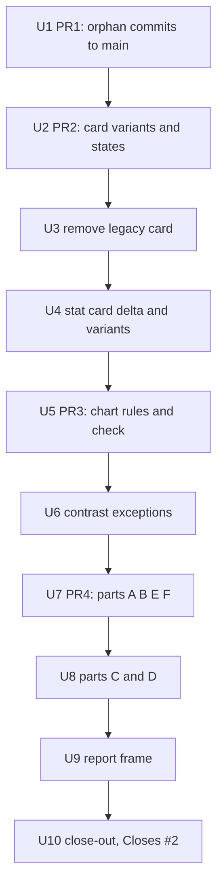

# One card, one stat card, chart rules and shared parts (issue #2, part 2) - Plan

Repo: vaszafei/apotypos-demo-redesign. All paths are under `docs/redesign/prototypes/` unless they start with `docs/` or `web/`.

## Goal Capsule

- **Objective:** Every prototype page gets its cards, stat cards and charts from one shared set of parts, `pages.html` shows all of them, and GitHub issue #2 is closed with every acceptance box ticked.
- **Means:** extend the existing `Dash.card` and `Dash.Stat` instead of adding a new builder (KTD1).
- **Authority:** the user's messages, then this plan, then the text of issue #2, then `docs/solutions/`.
- **Stop conditions:** stop and ask if any card or stat card box moves at any checked width, if a page needs a card added or moved to place a part, or if a color rule in R6 cannot be met without changing group colors.
- **Who finishes:** the user reviews each Netlify deploy preview and says "lets merge". Only the last PR carries `Closes #2`.

---

## Product Contract

### Summary

Part 2 of #2 makes the card and stat card complete (states, footer link, delta, named variants), removes the leftover duplicate card code, brings the chart rules into one place with a check, and adds the six audit patterns and the report frame as shared parts. The parts appear on `pages.html` only. No real page changes how it looks and no card is added to a page.

### Problem Frame

Part 1 (PR #100) put every color in `assets/tokens.css`. The structure side of #2 is still open. All 26 pages that show cards already build them through `Dash.card` in `assets/dash.js`, so the card is closer to "one" than the issue assumed. What is left:

- A second, older card (`ChartCard`, `KpiTile`, `KpiStrip`, `.card`, `.kpi-tile`) still ships in `assets/components.js` and `assets/app.css`, and `pages.html` still uses `.card` for three sections.
- The card has no error or loading state, and the stat card has no delta against the previous period.
- The 14px-radius look lives in two scattered rules (`.minimal .dcard`, `.story-grid .dcard`), and `.dstat` is restyled in `assets/mme.css` for two page shapes.
- Chart rules (gridline color, labels of 12px or more, one tooltip) are followed in places and unchecked everywhere. Three chart labels are 11px.
- Patterns A–F and the report frame from the 2026-10-22 live-site audit have no shared part. About half the live cards with no place in v2 come from them.
- Two follow-up commits from the cloud session (`d204ffb`, `1389d5f`) are on a branch but not on `main`.

### Requirements

**Cards and stat cards**

- R1. Every card on every page is built by `Dash.card` and styled by one definition in `assets/dash.css`. The older `ChartCard`, `KpiTile`, `KpiStrip`, `.card` and the unused `.kpi-*` rules are removed after a check that nothing uses it.
- R2. A card has a head (title, subtitle, info, tools), a body, an optional footer link, and empty, error and loading states.
- R3. Pages keep their look. The 8px card, and the 14px `.minimal` and `.story-grid` cards, become named variants of the one card (see Key Decisions).
- R4. A stat card shows value, label, sub line, an optional delta against the previous period, and an optional sparkline. The `.mme-kpi` and `.outlet-stats` shapes become named variants.

**Charts**

- R5. Every chart follows the same rules: gridlines use `--rule`, labels are 12px or more, direct labels replace legends where they fit, the tooltip is `UI.showTooltip`, and any range brush works the same way.
- R6. Text keeps 4.5 to 1 and marks 3 to 1 on their surface in every theme, and categorical slots stay apart for common color vision deficiencies. `pnpm check` enforces what can be measured. The exceptions left by part 1 are resolved or written down (Open Question 1).

**Shared parts**

- R7. Parts A (summary callout), B (method and limits block), C (period control with volume brush), D (entity × entity heatmap table), E (headline and quote list), F (filter chips and dataset switch) and the report frame exist as shared components. They are not placed on any real page.

**Reference and process**

- R8. `pages.html` shows every token (done in part 1), every card state, every stat card form, every chart type and every part.
- R9. No card or stat card moves or resizes on any page at 1920, 1440, 1100 and 390 px, in `paper` and `night`. The one exception is `pages.html`, whose three `.card` sections move to the `.dcard` style in U3 (24px padding becomes 12px 14px).
- R10. `main` carries the two follow-up commits from `claude/wizardly-pasteur-uizc4e`.
- R11. The checklist in issue #2 is ticked as each PR merges, and the issue closes with the last PR.

### Key Decisions

- **Pages keep their look; the card is one definition with variants.** (session-settled: user-approved — chosen over one radius for all cards: PR #98 made cards transparent and the story and minimal cards use 14px, so a single radius would change pages already approved. Proposed in the scoping step and accepted with "go".) Governs R1, R3.
- **New parts are not placed on pages.** (session-settled: user-approved — chosen over adding the audit cards to real pages: the user's standing rule is that cards are never added or moved unasked. Accepted with "go".) Governs R7.

### Success Criteria

- Searching `assets/` finds no `ChartCard`, `KpiTile`, `KpiStrip` or `.card {` rule. `.kpi-tile`, `.kpi-label` and `.kpi-value` stay: the home hero stats, the methodology contents heading and the count-up in `assets/motion.js` still use them.
- The layout comparison in the Verification Contract reports 0 differing boxes.
- `pnpm check` exits 0 and now also fails on a chart label under 12px.
- On `pages.html`, each card state, stat card form, chart type and part can be seen in `paper` and `night`.

### Scope Boundaries

Non-goals (considered, not built):

- A single radius for all cards. Not built because it changes approved pages; revisit if the user asks.
- Putting any part on a real page. Needs the user to say where.
- Navigation changes (#35) and the France report page itself (#38). The report frame is the component only.
- The `web/` Nuxt app. It only syncs the prototypes.

#### Deferred to Follow-Up Work

- Adoption of parts A–F and the report frame by real pages, one request at a time.
- Moving `messages-parts.js` keys into `messages.js` when a second page uses them.

---

## Planning Contract

### Key Technical Decisions

- KTD1. **Extend `Dash.card` and `Dash.Stat`.** All 26 pages that show cards already call `Dash.card`, and no page writes `class: 'dcard'` by hand. A new builder would add a third path. Governs R1.
- KTD2. **States are a `data-state` attribute plus a body helper.** `loading` reuses the existing `.skeleton` class, `empty` reuses `Dash.emptyText`, `error` reuses `UI.ErrorState` with its retry. The legacy `KpiTile` used the same `data-state` idea, so the name is not new. Governs R2.
- KTD3. **Variants are two custom properties, `--card-radius` and `--card-pad`.** `.dcard` sets them; `.minimal` and `.story-grid` override them in one block. The radii go in `assets/tokens.css` next to `--radius`. Governs R3.
- KTD4. **Delete the legacy card only after proving it is unused.** Follow `docs/solutions/workflow/verify-dead-exports-before-deleting.md`: search every html, js and css file, including selector lists such as `:is(.card, .dcard, .kpi-tile)` in `assets/app.css`. Governs R1.
- KTD5. **Enforce chart rules in `scripts/check.mjs` where they are mechanical.** A font-size under 12px on a chart text selector fails, and a literal stroke color is already caught by the hex rule. Rules that need eyes (direct labels instead of a legend) are checked on the reference page. Governs R5.
- KTD6. **New parts live in `assets/parts.js`, `assets/parts.css` and `assets/messages-parts.js`, loaded by `pages.html` only.** Class names are prefixed because plain names already exist: `.callout` (politics.css), `.chip` (dash.css, world.css), `.heat` and `.heat-cell` (politics.css, world.css). Use `sum-`, `method-`, `quote-`, `fchip-`, `hmx-`, `brush-`, `frame-`. Governs R7. Follows `docs/solutions/workflow/check-class-names-against-shared-css.md`.
- KTD7. **"No page changes" is proved by card boxes, not DOM.** Class names change on purpose in U2–U4, so the settled-DOM comparison in `docs/solutions/workflow/prove-no-visual-change-with-settled-dom.md` would report noise. Compare the bounding box of every `.dcard` and `.dstat` instead, with `reducedMotion: 'reduce'`. Governs R9.
- KTD8. **One PR per phase, `Closes #2` only on the last.** Each PR adds its section to `pages.html` so the deploy preview shows what shipped. Governs R8, R11.

### Delivery shape

---

## Implementation Units

### U1. Backport the follow-up commits (PR 1)

- **Goal:** `main` gets the theme-switch redraw fix, the `--shade` token for the 17 `rgba()` shadows, and the color-token lesson.
- **Requirements:** R10.
- **Dependencies:** none.
- **Files (from the two commits):** `assets/shell.js`, `assets/tokens.css`, `assets/app.css`, `assets/dash.css`, `assets/date-range.css`, `assets/home.css`, `assets/politics.css`, `scripts/check.mjs`, the `?v=` of all 29 html pages, `docs/prompts/2026-11-02-color-tokens/report.md`, `docs/solutions/conventions/color-tokens-and-the-check.md`.
- **Approach:**
  1. Branch `claude/theme-shade-tokens` from current `main`.
  2. Cherry-pick `d204ffb` then `1389d5f`.
  3. If the `?v=` numbers collide, take the highest on `main` plus 1 (shared-asset checklist step 1).
  4. PR body says part 1b of #2, no `Closes`.
- **Patterns to follow:** `docs/solutions/workflow/pr-and-merge-flow.md`; PR body is updated with `gh api -X PATCH`.
- **Test scenarios:**
  - After a theme switch on `fingerprints-v2.html`, the group tints match the new theme without reload.
  - `grep -c "rgba(" assets/*.css` shows no shadow `rgba()` left outside `tokens.css`.
  - `pnpm check` exits 0.
- **Verification:** `pnpm check`, plus `pnpm check:visual --themes paper,night` with no findings.

### U2. Card builder: variants and states (PR 2)

- **Goal:** The one card has head, body, footer link and four states, and the 14px looks are variants of it.
- **Requirements:** R2, R3, R9.
- **Dependencies:** U1.
- **Files:** `assets/dash.js` (`card`, `cardHead`, new `cardFoot` and `cardState`), `assets/dash.css`, `assets/tokens.css`, `assets/messages.js`, `pages.html`.
- **Approach:**
  1. Record the baseline first: the box of every `.dcard` and `.dstat` on `main` for every URL in the `PROTOTYPES` map of `assets/shell.js`, at four widths and two themes. Save it in the session scratchpad.
  2. Add `--card-radius` and `--card-pad` to `.dcard` and move the `.minimal` and `.story-grid` overrides into one block (KTD3).
  3. Add `Dash.cardFoot(link)` over the existing `.dcard-link`, used by the four pages that already render it.
  4. Add `data-state` support through `Dash.cardState(kind, text)` (KTD2). Only `empty` has callers today; `loading` and `error` have none.
  5. Add the «Κάρτες» section to `pages.html`: default, with subtitle, info and tools, with footer link, and each state, for both card shapes.
  6. Bump `?v=` for the changed assets on all pages.
- **Patterns to follow:** `Dash.Info` for the head; `UI.ErrorState`; `.skeleton` in `assets/app.css`.
- **Test scenarios:**
  - Baseline versus branch: 0 differing `.dcard` boxes on all pages at 1920, 1440, 1100 and 390 px in `paper` and `night`.
  - `pages.html`: the loading card shows a skeleton, the error card shows the retry button, and clicking it calls the handler once.
  - A `.minimal` page still has a 14px radius and a 16px 18px padding; a default page still has 8px.
- **Verification:** the layout comparison reports 0 differences; `pnpm check:visual` has no findings; a screenshot of `pages.html` card section at 1440 in `paper` and `night` was looked at.

### U3. Remove the legacy card

- **Goal:** One card definition remains in the code base.
- **Requirements:** R1.
- **Dependencies:** U2.
- **Files:** `assets/components.js` (`ChartCard`, `KpiTile`, `KpiStrip` and their entries in `window.UI`), `assets/app.css` (`.card`, `.card-title`, `.card-note`, `.card-footnote`, `.kpi-*`, and the selector lists that name them), `pages.html` (three `section.card` uses).
- **Approach:**
  1. Search all html, js and css for each name (KTD4). Known users today: only `pages.html` (`.card` three times). `card-col` is a layout column and stays.
  2. Move the three `pages.html` sections to `Dash.card`.
  3. Delete the dead code and trim the selector lists; check `git diff -U0 | grep '^-'` for lines removed by accident.
  4. Bump `?v=`.
- **Execution note:** characterize first. Record the `pages.html` section boxes before the change and compare after.
- **Test scenarios:**
  - `grep -rn "ChartCard\|KpiTile\|KpiStrip" .` finds nothing in `assets/` or the pages.
  - `pages.html` page tree and token sections render with 0 console errors, and their boxes differ from the baseline only by the card-style change (padding 24px becomes 12px 14px, the R9 exception).
  - The hover border still shows on a `.dcard`.
- **Verification:** `pnpm check:visual` has no findings; layout comparison unchanged for every page except `pages.html`.

### U4. Stat card: delta and variants

- **Goal:** `Stat` shows a delta against the previous period, and the compact shape is a named variant.
- **Requirements:** R4, R9.
- **Dependencies:** U2.
- **Files:** `assets/dash.js` (`Stat`), `assets/dash.css`, `assets/mme.css` (the `.mme-kpi` rules move to `.dstat-compact` in `assets/dash.css`; `.outlet-stats` stays a container layout of the outlet card), `pages.html`, callers in `assets/mme.js` and the pages that use `viz:`.
- **Approach:**
  1. Add a `delta` option as a fraction (0.12 is ▲ +12%). It renders the same `.delta` span that `media-v2.html` built by hand, so no page changes. Colors for ▲ and ▼ are not added: the live card shows the delta uncolored, and changing that was not asked.
  2. Add `variant: 'compact'` for the Μέσα › Επισκόπηση shape and use it in `media-v2.html` instead of the `c3` helper.
  3. Keep `viz` (5 callers) as the sparkline slot and document it on the reference page.
  4. Add the stat card forms to `pages.html`: value only, with sub, with delta up and down, with sparkline, text value, empty.
- **Patterns to follow:** `docs/solutions/conventions/layout-requests-are-literal.md` (arrows, not +/−); `docs/solutions/conventions/match-existing-type-and-controls.md` (existing sizes).
- **Test scenarios:**
  - `delta: 0.12` renders ▲ +12%; `delta: -0.08` renders ▼ −8%; `delta: null` renders only the short line.
  - A stat card with `empty: true` still shows the empty line and no delta.
  - Outlet page stat boxes and the media page `mme-kpi` boxes match the baseline.
- **Verification:** layout comparison reports 0 differences; `pnpm check` exits 0.

### U5. Chart rules and the check (PR 3)

- **Goal:** The five chart rules hold on every chart, and a check keeps them.
- **Requirements:** R5, R8, R9.
- **Dependencies:** U4.
- **Files:** `assets/dash.css` (`.bubble-name` 11px), `assets/home.css` (`.donut-cap` 11px), `assets/politics.css` (`.heat td.hc` 11px), `assets/components.js` (`BarChart` gridlines, `showTooltip`), `scripts/check.mjs`, `pages.html`.
- **Approach:**
  1. List every chart type with one example page: bar and stacked bar, line and area, sparkline, scatter (`media-v2.html`), matrix (`similarity-v2.html`), diverging bar, timeline (`cases-v2.html`), bubbles and sunburst (`groups-v2.html`), map (`OwnershipMap`).
  2. For each, record the gridline color, smallest label size, tooltip source and legend use. Fix deviations. Raising the three 11px labels to 12px is asked by the issue; measure that the bubble names and heat cells still fit, and report any that do not.
  3. Add to `scripts/check.mjs`: fail on `font-size` under 12px in selectors that style chart text (`svg`, `.chart`, `.heat`, `.bubble-name`, `.donut-cap`), with a short allow-list for non-chart uses (`.pill`, `.owner-tag`, `.party-table .sub`, `.home-arrow`).
  4. Add the «Διαγράμματα» section to `pages.html`: one example of every type with sample data, in both themes.
- **Patterns to follow:** `UI.CHART_FRAME` and `UI.smoothPath` (`docs/solutions/conventions/theme-tokens-only.md`).
- **Test scenarios:**
  - Re-adding `font-size: 11px` to `.bubble-name` makes `pnpm check` exit 1 and name the selector.
  - Every `.grid-line` computes to the `--rule` color in all five themes.
  - Hovering one mark in each chart type shows the same tooltip element.
- **Verification:** `pnpm check` exits 0; `pnpm check:visual --themes all` has no findings; screenshots of the three changed charts at 1440 were looked at.

### U6. Contrast exceptions

- **Goal:** R6 is either met or the exception is written down where the issue reader will see it.
- **Requirements:** R6.
- **Dependencies:** U5.
- **Files:** `assets/tokens.css` and `scripts/check.mjs` only if the user chooses to change group colors; otherwise the issue body.
- **Approach:** Part 1 kept the existing group palette by decision, which leaves slots 2–5 under 3 to 1 on the light card, three slot pairs close under color vision deficiency, and slot 1 near the accent (ΔE 12.4). Ask the user (Open Question 1) when this unit starts. Default if they do not want group colors changed: keep them, list the three exceptions in the issue's acceptance text and in the `pnpm check` output header.
- **Test scenarios:**
  - Test expectation: none -- this unit records a decision. If colors change, the existing contrast checks in `scripts/check.mjs` are the test.
- **Verification:** the issue text and `pnpm check` output agree on the exceptions.

### U7. Parts A, B, E, F (PR 4)

- **Goal:** Four content blocks exist as shared parts.
- **Requirements:** R7, R8.
- **Dependencies:** U5.
- **Files (create):** `assets/parts.js`, `assets/parts.css`, `assets/messages-parts.js`. **Modify:** `pages.html`.
- **Approach:**
  1. **A, summary callout** (`sum-`): a heading and a short list of generated findings with links («Η περίοδος σε 3 σημεία», «Τι ξεχωρίζει στο διάστημα», «Στα γρήγορα»).
  2. **B, method and limits** (`method-`): «Μέθοδος και όρια» block for the end of a page; collapsible text, not an info pop-up.
  3. **E, headline and quote list** (`quote-`): headline with angle, frame and stance; verbatim quote with source and link; expandable «Δείτε παραδείγματα».
  4. **F, filter chips and dataset switch** (`fchip-`): one chip row with counts, and the Ελλάδα / Ισραήλ switch built on the existing `.segmented`.
  5. Each part is a function that returns a node, builds inside `Dash.card`, reads only tokens, and has Greek and English strings in `messages-parts.js` (both languages, no unused keys).
  6. Search the shared CSS for each class name before use (KTD6).
- **Patterns to follow:** `Dash.card`, `h()` from `assets/components.js`; selected state is a tinted accent fill with an accent border, number stays dark (`layout-requests-are-literal.md`).
- **Test scenarios:**
  - Each part renders in `paper` and `night` with 0 console errors.
  - A: with 0 findings the part renders the empty line, not an empty list.
  - E: «Δείτε παραδείγματα» expands and collapses, and the link of a quote has `rel="noopener"` when external.
  - F: selecting a chip sets `aria-pressed` and calls the handler with the key; the switch is keyboard reachable.
  - No existing page's boxes change (the parts file loads on `pages.html` only).
- **Verification:** `pnpm check` exits 0; `pnpm check:visual --only pages` has no findings; screenshots at 1440 and 390 were looked at.

### U8. Parts C and D

- **Goal:** The period control with a volume brush and the entity × entity heatmap table exist as parts.
- **Requirements:** R5, R7, R8.
- **Dependencies:** U7.
- **Files:** `assets/parts.js`, `assets/parts.css`, `assets/messages-parts.js`, `assets/date-range.js` (read only unless the brush needs a hook), `pages.html`.
- **Approach:**
  1. **C** (`brush-`): chips, from/to selects and a daily histogram that sets the range by dragging. Reuse `assets/date-range.js` for the range model so the page-level control and the brush stay in step. This is the single range brush named in R5.
  2. **D** (`hmx-`): a table with row and column entities, one sequential scale from `Dash.seq(v)`, text color from the same step, and masked cells under a minimum n.
  3. Show both on `pages.html` with generated sample data.
- **Test scenarios:**
  - C: dragging across days 3 to 9 sets from/to to those dates and fires one change event; dragging backwards is normalized.
  - C: the chips and the selects update the brush selection.
  - D: a cell under the minimum n renders masked and has no tooltip value; the darkest step keeps 4.5 to 1 against its text.
  - D: 12 rows × 8 columns scrolls inside the card at 390 px, with no horizontal scroll on the page.
- **Verification:** `pnpm check` exits 0; screenshots of C and D at 1440 and 390 in `night` were looked at.

### U9. Report frame

- **Goal:** A page type that frames a standalone document inside the shell exists.
- **Requirements:** R7, R8.
- **Dependencies:** U7.
- **Files:** `assets/parts.js`, `assets/parts.css`, `assets/messages-parts.js`, `pages.html`. Reads `reports/france-riots/` and `france-v2.html` for the existing way a report is loaded.
- **Approach:** A frame with a title bar (back arrow, title, "open alone" link) and the document below, inside the shell's normal page width. It takes a document URL and a title. It is shown on `pages.html` with the existing `reports/france-riots/` file as the sample. Issue #38 decides where it is used.
- **Test scenarios:**
  - The frame loads the sample document with 0 console errors and no horizontal scroll at 390 px.
  - The "open alone" link opens the same URL in a new tab with `rel="noopener"`.
  - A document that fails to load shows the card error state from U2.
- **Verification:** `pnpm check:visual --only pages` has no findings.

### U10. Close-out (PR 4, last commits)

- **Goal:** The issue is accurate and closes with the merge.
- **Requirements:** R8, R11.
- **Dependencies:** U1–U9 merged or in the last PR.
- **Files:** `docs/prompts/2026-11-03-shared-parts/report.md`, `docs/solutions/` (one lesson via `ce-compound`), issue #2 body.
- **Approach:**
  1. Write `report.md` with the real commands and measurements.
  2. Tick the issue's checklist items one by one against evidence; edit the body with `gh api` for anything changed by Open Question 1.
  3. The last PR body says `Closes #2`.
  4. Record the lesson with `/ce-compound`.
- **Test scenarios:**
  - Test expectation: none -- documentation and issue bookkeeping.
- **Verification:** after the merge, `gh issue view 2 --json state` reports `CLOSED`, and the checklist in the body has no unticked box without a stated reason.

---

## Verification Contract

| Gate | Command or check | When |
|---|---|---|
| Colors and chart rules | `pnpm check` in `web/` (exit 0) | every unit |
| Errors, 4xx, horizontal scroll | `pnpm check:visual --themes paper,night` in `web/`; `--themes all` once per PR; `--only <text>` while iterating | every PR |
| No page moved | Playwright script in the session scratchpad: boxes of `.dcard` and `.dstat` on `main` versus branch, all pages, 1920/1440/1100/390 px, `paper` and `night`, `reducedMotion: 'reduce'` (KTD7) | U2, U3, U4, U5 |
| Cache bump | `?v=` raised on all pages for each changed shared asset (`docs/solutions/workflow/shared-asset-change-checklist.md`) | every unit that edits an asset |
| Looked at | A screenshot of each changed section of `pages.html` at 1440 in `paper` and `night`; 390 px for U7–U9 | every PR |

Serve with `python3 -m http.server 8765` from `docs/redesign/prototypes`. Stop it with `kill $(lsof -ti:8765)`. Say in each PR which widths were measured only and which were looked at.

## Definition of Done

- Every R in the Product Contract is met, or Open Question 1 has a recorded answer for R6.
- No dead code from abandoned attempts is left in the diff.
- `rg "ChartCard|KpiTile|KpiStrip" docs/redesign/prototypes` finds nothing.
- `pnpm check` exits 0 on `main` after the last merge.
- Issue #2 is closed and its checklist matches `report.md`.
- A lesson is in `docs/solutions/`.

## Open Questions

1. **R6 exceptions (decide at U6, does not block U1–U5).** Slots 2–5 are under 3 to 1 on the light card, three slot pairs are close for color vision deficiencies, and slot 1 is near the accent. Part 1 kept the group palette by decision. Either keep the colors and write the three exceptions into the issue, or change the group colors and accept that group colors shift on pages. Default: keep and document.
2. **One radius (deferred).** The issue says one radius; this plan keeps 8px and 14px as variants (Key Decisions). Say so if you want one.

## Risks

- Raising three 11px chart labels to 12px may overflow small bubbles or heat cells. U5 measures each and reports instead of shrinking padding unasked.
- Greek wording for the new parts is mine. The user reviews it on the deploy preview.
- The stat card variant change edits `assets/mme.css`, which many outlet and media pages load. The box comparison in U4 is the guard.
