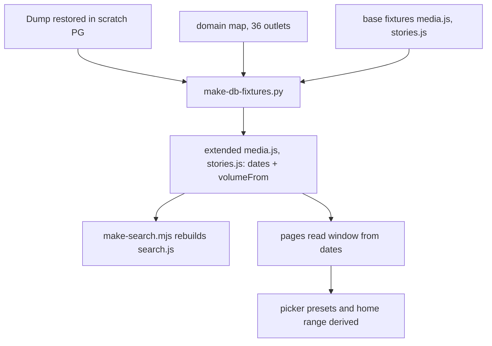

# October data from the DB dump - Plan

## Goal Capsule

- **Objective:** A visitor to the demo sees Aug through Oct 2026 wherever the data exists, and the end date comes from the data, so the next dump moves it forward with no page edits.
- **Means:** A repeatable generator that reads the restored `ta_blepo` database and appends October to the media and story fixtures (KTD3, KTD4).
- **Authority:** The user's words in this session, then this plan, then `CLAUDE.md` and `docs/solutions/`. The recorded decisions in KTD1 to KTD3 are not overridden silently.
- **Stop conditions:** Stop and tell the user if October volume per outlet differs from the Aug–Sep level by more than a factor of 3 (R4 check), or if a page needs a topic, frame or stance value for October that the DB cannot give.
- **Finish and ship:** `ce-work` builds on branch `claude/db-fixtures`, then `ce-code-review`, then one pull request. The user merges.

---

## Product Contract

### Summary

The generator adds October to the media (outlet volumes) and stories fixtures, from the dump. The date picker and the home range take their bounds from the fixtures instead of constants. Aug–Sep stays as it is, and every page whose data the dump cannot extend keeps its own window.

### Problem Frame

The demo's fixtures were built once from apotypos.org's public JSON and stop at 30 Sep 2026. The user now has a database dump of the apotypos backend, taken 2026-10-28, and wants the demo to show the update.

The dump is the raw pipeline, not the analysed data the pages are built on. It holds articles by domain, events and daily stories. It has no topics, frames, stances, portrayals, clickbait labels, groups or persons. Almost all of it is October: 296,255 of 296,836 articles, and daily stories for 13–27 Oct only.

The date window is also written into the pages: `index.html`, `components.js` (the picker presets) and the month labels. A longer window needs those to become data-driven, which is what the user asked for ("the window should by dynamic not fixed").

### Key Decisions

- **Rebuild the fixtures from the DB.** The user picked this over restoring only and over adding a live database to the app. Governs R1, R3, R4, R7. (session-settled: user-directed — chosen over a restore-only step and over a Postgres-backed app: the user answered "Rebuild the fixtures from the DB" when shown the three options)
- **The window is dynamic.** The end date comes from the data. The user wrote: "the window should by dynamic not fixed". Governs R1. (session-settled: user-directed — chosen over a fixed Aug–Oct constant). My reading of "dynamic" as "derived from the fixtures' own dates" is my call, in the scope the user confirmed with "go"; a visitor-chosen range is not what I built, because the date-picker presets already exist.
- **The demo reads Aug to Oct.** The user wrote: "of course it has to say from august to october, i said we have an update right?". Governs R2, R3.

### Requirements

**Window**

- R1. Each page takes its first and last day from the fixtures it reads. No page or shared asset holds `2026-08-01`, `2026-09-30` or a month name of the data as a constant.
- R2. Every Aug–Sep value in `media.js` and `stories.js` stays as it is today, and a day index that points at an Aug–Sep day still points at it.

**October from the DB**

- R3. `media.js` gets October days with articles per known outlet per day, for the 36 outlets the fixture already lists. An outlet the DB does not carry gets `null` for every October day, not zero.
- R4. October volume per outlet stays in the same order of magnitude as Aug–Sep (factor of 3 either way), or the run stops and reports it.
- R5. `stories.js` gets October stories from the DB's daily stories, joined across days by the DB's `continues` links, with a name, the count of known outlets, and the days they ran.
- R6. A story or an outlet-day shows no value, not zero, for what the DB cannot give: topic, frame, stance, portrayal, clickbait. A page that computes a rate from those fields skips October days instead of counting them as zero.

**Repeatable and safe**

- R7. One command rebuilds the extended fixtures from the database and the base fixtures. A second run on the same inputs gives the same files.
- R8. The dump file never enters git.
- R9. Fixtures the dump cannot extend (topics, groups, persons, stances, Gaza, Israel, war, elections, speeches, cases, campaigns, `mme.js`) keep their data and their own windows.

### Scope Boundaries

- Outside this plan: October topics, groups, owners, persons, stances and the Gaza/Israel/war pages. The dump holds nothing for them, and inventing values is not an option.
- Outside this plan: a live database in the app. The Netlify deploy stays static.
- Outside this plan: `mme.js` (people and topic matrices). It is analytical and has its own sets.
- Considered and not built: a second generator for the 543 domains that match no known outlet. The pages list 36 outlets and no group is defined for the others. Evidence that would change this: a request for a page of all 579 sources.
- Considered and not built: filling the days 1–12 and 28–29 Oct of the stories fixture with a different clustering. The DB's daily stories start on 13 Oct; the gap stays visible.

### Success Criteria

- With the extended fixtures, the Μέσα picker offers Aug–Oct, with a preset per month and a last-two-weeks preset counted from the last data day, and no page logs a console error or shows a zero as if it were a measurement.
- Changing only the fixtures (a later `dates` end) changes every bound and preset, with no edit to a page.

---

## Planning Contract

### Key Technical Decisions

- KTD1. **The window is the fixture's own `dates` array.** `UI.periodPresets` takes the dates (or the fixture window) and builds `all`, one preset per calendar month in the range, and `last14` from the last day. Month labels come from `fmt.date`, not from one message key per month, so the `range.aug` and `range.sep` keys go. Governs R1. This follows the user's decision on the dynamic window.
- KTD2. **October is appended, and a marker says where the DB starts.** The fixtures get `volumeFrom` (first day taken from the DB). The generator drops every day at or after `volumeFrom` before it appends, so a rerun, or a newer dump, never doubles October. Governs R2, R7.
- KTD3. **The generator reads the database through `psql`, with no Python packages.** It follows the existing scripts: `python3 -I`, one script per source, a cache-free read. It lives in `docs/redesign/prototypes/scripts/` as `make-db-fixtures.py`. Governs R7. My call: the other generators have no dependencies, and the client `psql` 14 can query the PG 18 scratch server.
- KTD4. **Outlets are matched by a committed domain map.** A file maps each of the 36 fixture outlets to its domain (for example Proto Thema to `protothema.gr`). The fixtures hold slugs, not domains, so the map is new input. A fixture outlet with no entry fails the run. An entry with a `null` domain and a reason is allowed: the DB carries only 26 of the 36 outlets, and a look-alike domain that cannot be verified from the fixtures stays `null` (Makedonia, Voria). Governs R3, R5, R9. Domains outside the map count nowhere.
- KTD5. **Missing is `null`, not `0`.** An October outlet-day is `[articles, null, null, null]` (the fixture's tuple is analysed rows, news rows, rows with a clickbait label, clickbait rows). A story's topic is the fixture's existing catch-all issue, flagged so the pages can tell it from a real one. Pages that sum or divide these fields skip `null`. Governs R6.
- KTD6. **A story is a chain of daily stories.** Each daily story is a node, each `continues` link joins two, and a chain is one story with its days. The name is the headline of the first article of the chain's first day (the exact pick is a deferred detail). The outlet count is the number of known outlets in the chain. Governs R5.
- KTD7. **The window ends on the last complete day.** The dump was taken on 2026-10-28 at 15:53 UTC, and articles run to 2026-10-29 06:00, so the last day is incomplete. The generator takes `--as-of` (the dump date) and ends on the last day with a complete count (the rule is a deferred detail, stated in U2). Governs R1.

### High-Level Technical Design

### Assumptions

- The DB's article count per outlet per day is comparable to the fixture's analysed rows. The fixtures count rows that apotypos analysed, the DB counts everything it scraped. U2 measures this (R4) and stops if it is off.
- The fixtures' day is a UTC calendar day. U2 checks how `make-fixtures.py` assigns a day and uses the same rule for `published_at`.
- Story rows carry a name and no links. I told the user earlier that story rows keep headlines and links; the fixture has names only, so October stories get a name only unless U3 finds a page that lists article links.

### Dependencies and Risks

- The scratch database must be running (container `apotypos-scratch-pg`, port 54329). The generator reads it, so a later session needs the container, or a restore of the dump.
- Risk: a page computes a rate from the clickbait or news fields and shows 0% for October. R6 and U4 cover it, and the visual check must show those cards.
- Risk: `components.js` is shared by many pages, so the cache-busting `?v=` bump and the full visual check apply (`docs/solutions/workflow/shared-asset-change-checklist.md`).
- The 36 outlets are the base. If a domain changed in October (a rename), its volume falls to zero. U2 reports outlets with fewer October days than Sep days.

---

## Implementation Units

### U1. Outlet domain map and dump hygiene

**Goal:** Give the generator its one new input, and keep the dump out of git.

**Requirements:** R3, R8; KTD4.

**Dependencies:** none.

**Files:**
- `.gitignore` (add `*.dump`)
- `docs/redesign/prototypes/scripts/outlet-domains.json` (new)

**Approach:**
- Map each of the 36 outlets in `data/media.js` to the domain of the `sources` table that carries its articles. Check each against the DB, and report an outlet whose domain is missing from `sources`.
- Add the dump pattern to `.gitignore`. The file stays on disk, untracked.

**Test scenarios:**
- Every outlet name in `data/media.js` has exactly one entry, and each non-null domain exists in `sources`.
- Each `null` entry carries a reason, and 26 entries have a domain.
- `git status` no longer lists `manual-20261028T155347Z.dump`.

**Verification:** The map loads and has 36 entries; the dump is ignored.

### U2. Extend `media.js` with October outlet volume

**Goal:** `media.js` shows Aug through the last complete October day, with outlet volume.

**Requirements:** R2, R3, R4, R6, R7; KTD2, KTD3, KTD5, KTD7.

**Dependencies:** U1.

**Files:**
- `docs/redesign/prototypes/scripts/make-db-fixtures.py` (new)
- `docs/redesign/prototypes/data/media.js` (regenerated)
- `docs/redesign/prototypes/scripts/check.mjs` (extend)

**Approach:**
1. Parse the base fixture, cut it at `volumeFrom` if it is set, and keep the Aug–Sep arrays as they are.
2. Query articles per mapped domain per day with `psql`, using the same day rule as `make-fixtures.py`.
3. Append the October days to `dates` and to each `outletDaily` row as `[n, null, null, null]`; leave `issueDaily` and `storyDays` to U3.
4. Set `window`, `volumeFrom` and `updatedAt`. Take the end from the last complete day under `--as-of`: the last day before the as-of date whose count is at least half the median of the days before it.
5. Compare each outlet's October daily mean with its Aug–Sep mean and stop on a factor above 3.

**Execution note:** Characterise first: write the check that Aug–Sep values are identical before the generator runs, so R2 is proven, not assumed.

**Patterns to follow:** `scripts/make-fixtures.py` (fixture file format, `window.FIXTURES[...]` wrapper).

**Test scenarios:**
- Covers R2. Regenerate on the unchanged base: every Aug–Sep cell equals the committed value.
- Covers R7. Run twice: the two outputs are byte-identical, and `dates` has no duplicate day.
- An outlet-day with no articles gets `[0, null, null, null]`, not `[null, ...]`.
- A mapped outlet with zero October articles is reported and does not abort the run.
- `--as-of` earlier than the data end cuts `dates` at that day.
- R4: an outlet 4× above its Aug–Sep mean stops the run with the outlet name.

**Verification:** `dates` runs 2026-08-01 to the last complete day, and `check.mjs` passes with the new fixture checks.

### U3. Extend `stories.js` and `media.js` stories with October stories

**Goal:** October stories exist where the story pages read them.

**Requirements:** R5, R6, R7; KTD5, KTD6.

**Dependencies:** U2.

**Files:**
- `docs/redesign/prototypes/scripts/make-db-fixtures.py`
- `docs/redesign/prototypes/data/stories.js` (regenerated)
- `docs/redesign/prototypes/data/media.js` (regenerated: `storyDays`)
- `docs/redesign/prototypes/data/storyDetail.js` (regenerated: dates only)

**Approach:**
1. Build chains from `daily_stories` and `story_links` (all links are `kind = continues`, `state = active`).
2. For each chain write the story row (`id`, name, `issue` = the catch-all, `outlets` = known outlets, `days` = pairs of day index and article count) and the `storyDays` row, with ids after the last Aug–Sep id.
3. Take the name from the headline of the chain's first article. If a page lists article links, read it first and decide then whether to add them (see Assumptions).
4. Extend `dates` in `storyDetail.js` to match, and give October stories no detail row. The fixture already has 5,062 stories and 5,038 detail rows, so a story without detail is an existing case; confirm in `story-v2.html` that it renders.

**Test scenarios:**
- A chain of three daily stories gives one story with three day entries.
- A daily story with no link gives a one-day story.
- A story seen only by unmapped domains is dropped, not given `outlets: 0`.
- Aug–Sep story ids and rows are unchanged (R2).
- `story-v2.html?id=<an October id>` renders without a console error and shows no detail card with zeros.
- 1–12 and 28–29 Oct have no stories, and the pages show the empty days as empty.

**Verification:** The stories list and counts grow by the October stories only; the story page opens for an October id.

### U4. Make the window dynamic in the shared assets and pages

**Goal:** No page holds the window as a constant, and no page counts a missing October value as zero.

**Requirements:** R1, R6; KTD1, KTD5.

**Dependencies:** U2.

**Files:**
- `docs/redesign/prototypes/assets/components.js` (`periodPresets`, shared)
- `docs/redesign/prototypes/assets/messages.js` (remove `range.aug` and `range.sep`, in both languages)
- `docs/redesign/prototypes/index.html` (`range` at line 37)
- `docs/redesign/prototypes/pages.html` (the preset demo, line 197)
- `docs/redesign/prototypes/media-v2.html`, `outlet-v2.html`, `group-v2.html`, `groups-v2.html` (read `outletDaily` fields)
- every page that loads `components.js` (cache-bust `?v=`)

**Approach:**
1. Change `periodPresets` to take the dates and return `all`, one preset per month in range, and `last14` from the last date. Update the callers.
2. In `index.html`, read the range from `FIXTURES.home.window`.
3. For each reader of `outletDaily` fields 1 to 3 (clickbait and news rates), skip `null` in sums and in the denominator, and show the existing empty state when a whole range has none.
4. Bump `components.js?v=` on all pages (highest on `main` plus 1), and `messages.js?v=`.

**Test scenarios:**
- Covers R1. Set a fixture's last date to 2026-11-15: presets show Aug, Sep, Oct, Nov and a last-14 ending on 15 Nov, with no page edit.
- A range inside September gives the same numbers as today (R2).
- A range inside 13–27 Oct on `outlet-v2.html` shows volume and no clickbait rate; it shows the empty state, not 0%.
- A range spanning 20 Sep to 10 Oct counts only the analysed days in the rate.
- Both languages show the month names from `fmt.date`, with no missing message key.

**Verification:** `grep` finds no `2026-08-01` or `2026-09-30` in `assets/` or the pages that read fixtures (the war page keeps its own 31 Aug split, which belongs to its unchanged data).

### U5. Rebuild the search index and run the checks

**Goal:** The new stories are searchable, and the whole demo passes its checks.

**Requirements:** R5, R7, R9; `docs/solutions/workflow/shared-asset-change-checklist.md`.

**Dependencies:** U3, U4.

**Files:**
- `docs/redesign/prototypes/data/search.js` (regenerated by `scripts/make-search.mjs`)
- `docs/redesign/prototypes/data/sources.json` (record the dump as a source)

**Approach:**
1. Run `make-search.mjs` against the extended fixtures. Check the size of `search.js`, which grows with the story rows.
2. Record in `sources.json` the dump's name, `--as-of` date, and row counts, so a later reader can tell the data's origin.
3. Run the checks in the Verification Contract, and look at the screenshots of the pages that use the changed assets.

**Test scenarios:**
- Search for a word in an October story headline returns that story.
- `search.js` growth is reported in bytes, and the first-open load is checked against the home page's budget noted in the layout-pass handoff.

**Verification:** All three check scripts pass, and the screenshots show the October days on the Μέσα pages at 1440 and 1920, in `paper` and `night`.

---

## Verification Contract

| Gate | Command (from `web/`) | Applies to |
|---|---|---|
| Page and fixture checks | `pnpm check` | U2, U4 |
| Visual check, all pages, 1920/1440/1100/390, paper and night | `pnpm check:visual` (about 3 min) | U4, U5 |
| Parts check | `pnpm check:parts` | U4 |
| Search index | `node ../docs/redesign/prototypes/scripts/make-search.mjs` | U5 |
| Idempotent rebuild | run `make-db-fixtures.py` twice and compare the output files | U2, U3 |

Report plainly which widths were measured and which were looked at (`docs/solutions/workflow/shared-asset-change-checklist.md`).

## Definition of Done

- All units pass their verification, and the gates above pass.
- Aug–Sep values are identical to the committed ones (R2), shown by a comparison, not asserted.
- The dump is ignored by git and not in any commit.
- No abandoned experiment code or scratch files are in the diff.
- `docs/prompts/<date>-db-fixtures/report.md` holds the real commands and measurements, and `ce-compound` records the lesson in `docs/solutions/`.
- The user is told which cards show no October data, and why.

## Deferred to Implementation

- The exact pick of a story's name from the chain's first day.
- The rule for the last complete day, if the half-of-median rule misfires on a weekend.
- Whether a story page lists article links, which decides if links are added.
- The day rule for `published_at` (UTC against Athens time), taken from `make-fixtures.py`.

## Open Questions

None blocking. The user may still redirect the reading of "dynamic" in KTD1.
