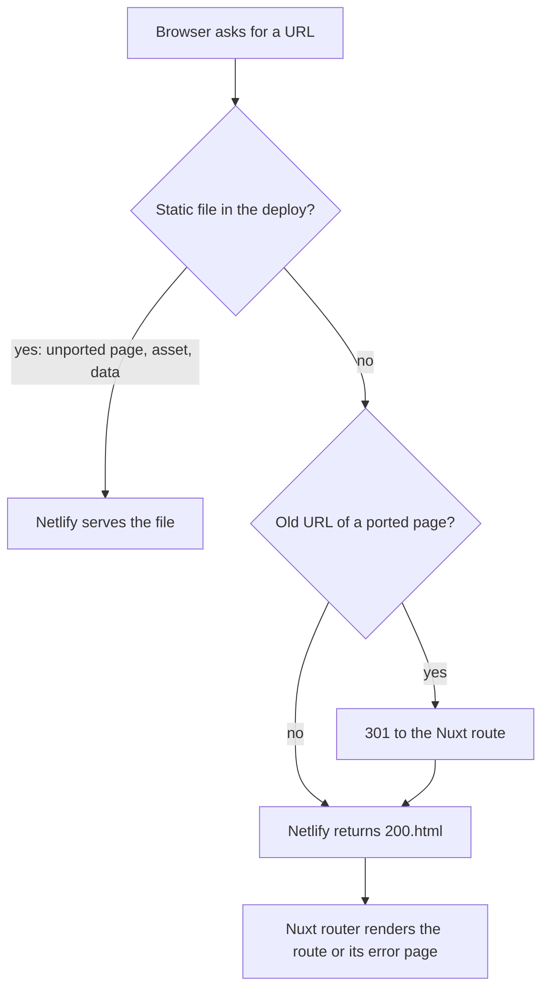

# Nuxt App Migration - Plan

## Goal Capsule

- **Objective:** The whole demo is one Nuxt app that looks exactly like today's pages, so the user and Claude change a chart, a card or the shell once, in a component, and not as copies across 26 pages.
- **Means:** A strangler migration, one page per pull request, into `web/` (KTD1, KTD2).
- **Authority:** The user's words, then the Requirements, then the Key Technical Decisions, then the units. A unit never overrides a Requirement.
- **Stop and ask when:** a pixel diff has a band nobody can explain, a page needs a design change to be ported, a decision marked "my call" turns out wrong, or the context passes 70% (write a handoff with `ce-handoff`).
- **Who ships:** `ce-work` or the user's session builds each unit on its own `claude/<short-name>` branch. The user checks the Netlify preview and merges only after "lets merge".

---

## Product Contract

### Summary

Move the 26 static HTML prototypes in `docs/redesign/prototypes/` into one Nuxt app in `web/`, page by page. Each page is checked against its static page by pixel diff before it is merged. The unported pages keep working the whole time. At the end the static pages, the copy script and the `?v=` bumps are gone.

### Problem Frame

The app is hand-built HTML. Pages share code by copying scripts and by bumping `?v=` numbers, three donut charts exist as three copies, and every shared change has to be checked by hand on every page (`docs/solutions/workflow/shared-asset-change-checklist.md`). The user wants better performance, page transitions and display, and a codebase where Claude and the user work with components. A trial of Θέματα (PR #128) showed that the same design can be reproduced to the pixel in Nuxt: 162 of 1.8 million pixels differ at 1440, and the shell stays mounted on a page change. The trial's second page was a stub, so the speed gain on a page change is not yet proven. The first trial used Nuxt UI and Tailwind and looked different, so the user rejected it.

### Requirements

**Look and behavior**

- R1. A ported page renders like its static page: pixel diff within the limit in the Verification Contract at 1440 and 390, with the date picker open, on hover, and in the night theme.
- R2. Ported pages use the prototype CSS and class names unchanged. Tailwind 4 may be used for new parts only, without its reset. Nuxt UI is not used.
- R3. A page change keeps the prototype's slide, with its direction and its start from the scrolled position.
- R4. What every page has works in Nuxt: the sign-in gate, the auth drawer, the global search, the theme, font and icon switches, the Greek and English text, and the `?state=empty` and `?state=error` demo states.

**Migration**

- R5. The app lives in `web/` as one Nuxt app with ordinary names (no "spike"), and Netlify deploys it.
- R6. A route that is not ported yet keeps working as it does today. The old URL of a ported page redirects to its new route, so links in the static pages keep working.
- R7. Each page is a small pull request with a Netlify preview, merged only after "lets merge".
- R8. Only live code is ported. Code the handoffs list as dead is checked with grep and then left behind.
- R9. Text and data come from the existing message keys and fixtures through scripts, not retyped.

**Checks and end state**

- R10. The repo has Nuxt versions of the pixel diff and of the visual, parts, fixtures and color checks.
- R11. At the end the static pages, `web/scripts/sync-prototype.mjs`, the `?v=` bumps and the `nuxt-spike/` folder are gone, and the README and `CLAUDE.md` describe the Nuxt app.

### Key Decisions

- **Exactly the same design as the HTML.** The user: "i want exactly the same design as we have worked". Governs R1, R2.
- **A professional Nuxt app, not a spike.** The user: "why you tell them spikes? we have to have a profational nuxt app", and "its has to be a profational nuxt app so yes". Governs R5.
- **Strangler, page by page, static pages still served.** (session-settled: user-directed — chosen over one long branch: the user picked the strangler option in the question that showed both.) Governs R6, R7.
- **Tailwind 4 without its reset, for new parts only; no Nuxt UI.** (session-settled: user-approved — the agent proposed it after the user asked "why not tailwind?"; the user answered "lets go".) Governs R2.
- **Ιδιοκτησία is the first new page**, so the page-change test is fair. (session-settled: user-approved — the user answered "yes" to the question that named it.) Governs R1.

### Success Criteria

These are my targets, not the user's. The user can change them.

- For Ιδιοκτησία, the median page change at normal CPU is within 10% of the static page (the trial measured 238 ms for the static page from Θέματα), and at 4× CPU it is not slower than the static page (1898 ms in the trial).
- For every ported page, the first load is at most 10% larger in bytes than the static page.
- The report of each page states which numbers were measured and which screens were only looked at.

### Scope Boundaries

**Outside this plan**

- Any design change. A page that needs one is a separate pull request on the Nuxt page, after the port.
- A real backend or API. Pages read converted fixtures.
- Nuxt UI, Safari testing, and the dead code the handoffs list (`Mme.ChipsCard`, `Mme.TopicCard`, `Mme.AgendaCard`, `Mme.GovCard`, `Mme.StoriesCard`, `Dash.StoryFlow`, `Spread.matrix`, `Spread.Ring`, unused message keys, `.legend-toggle*`, `d3-hierarchy`).

**Considered and not built**

- A GitHub Action that runs the pixel diff on every pull request. The Netlify preview and the user's screenshot are the review today. Evidence that would change this: a regression that reaches `main` without being seen.
- A shared design-system package. The prototype CSS stays in one place until U17.

**Deferred to Follow-Up Work**

- Server rendering with prerender, decided by U16 from a measurement.
- Wiring a real API in place of the fixtures.

### Outstanding Questions

**Deferred to implementation**

- Whether the message files are one file per language or one per prototype message group, decided by the bundle size in U5.
- The order of the pages in U9 to U15, which is the user's call before each unit starts.
- How the Home hero (`hero-field.js`, a canvas) is ported, as a component or as a script kept as is, decided in U14.

**Needs the user's confirmation (default shown)**

- npm instead of pnpm in `web/`. `pnpm` does not run on this machine (mise error), the trial used npm, and Netlify supports both. Default: npm with `package-lock.json`, and the Netlify command becomes `npm run generate`.

---

## Planning Contract

### Key Technical Decisions

- KTD1. **One app in `web/`; the static site is served beside it until the last page is ported.** `web/` keeps the Nuxt app (`ssr: false`, static preset). The sync script is reduced to copying the not-yet-ported static pages with their `assets/` and `data/` into `web/public/`. A single file `web/ported-pages.json` lists each ported page as `{ html, route, query? }`; the sync script skips those pages, and the navigation reads the same list. Governs R5, R6.
- KTD2. **Redirects keep the static links alive, and the sync script writes them.** The static shell keeps linking to `groups-v2.html` and the like, and no static page is edited when a page is ported. The sync script generates `web/public/_redirects` from `ported-pages.json`: one 301 per ported page (a page with a tab query such as `media-v2.html?tab=writing` uses Netlify's query matching), then the fallback `/* /200.html 200`, which is not forced, so existing static files win over it. The `nitro` preset is `static`, so `routeRules` do not write Netlify redirects. Redirects work on the Netlify preview, not on a local static server; pixel diffs load the real URLs directly. Governs R6.
- KTD3. **Nuxt links to a ported route with the router and to an unported route with a plain link.** The navigation reads `ported-pages.json`. A move between the two worlds is a full page load. The static CSS already opts in to cross-document view transitions, so I expect the slide to still play there; U1 verifies it. Governs R3, R6.
- KTD4. **The prototype CSS has one source until U17: `docs/redesign/prototypes/assets/`.** The sync script copies it to `web/public/assets/`, and Nuxt links it as `/assets/*.css`. It is never edited in `web/`. A CSS edit therefore reaches both worlds, and `docs/solutions/workflow/shared-asset-change-checklist.md` applies until U17. U17 moves the files into `web/app/assets/css/`.
- KTD5. **Once a page is ported, its HTML file is frozen** and stays in `docs/redesign/prototypes/` as the pixel reference. Later changes to that page go into the Nuxt page only. Design work on unported pages continues as today. This is my call, from the user's "page by page" choice.
- KTD6. **Tailwind 4 is imported as `theme.css` and `utilities.css` with `prefix(tw)`, and without `preflight.css`**, through `@tailwindcss/vite`. Prefix and no reset are both needed. The prototype tokens `--text-*`, `--font-*`, `--radius` and `--ease-*` use names in the same families that Tailwind's theme uses, so an unprefixed theme would turn `--text-primary` (a color in the prototype) into a font-size class. Design tokens are mapped into `@theme` by hand and only as needed. (session-settled: user-approved — chosen over plain CSS only and over full Tailwind: new parts get a modern toolkit, existing pages keep their CSS.) Sources: Tailwind docs, "Disabling Preflight". Governs R2.
- KTD7. **Text uses `@nuxt/i18n` with `strategy: 'no_prefix'` and lazy JSON per language.** The prototype's `{name}` syntax is the same as vue-i18n's named interpolation, and no message contains `|` or `@`, which vue-i18n reads as special. A script converts `assets/messages*.js` to JSON with the same layering order (the page files override `messages.js`). Greek is the fallback, as `t()` does today. The locale keeps the key `apotypos-locale` and the `?lang=` parameter. This is my call, chosen over a small `useT()` over the same keys: it is the standard module and handles both languages. Governs R4, R9.
- KTD8. **Data is converted by a script and read by one composable.** `web/scripts/build-fixtures.mjs` runs each `data/*.js` in a `node:vm` sandbox with a fake `window.FIXTURES` and writes `web/public/data/<name>.json`. `useFixture(name, { required, isEmpty })` fetches it on the page that needs it, keeps the shape check of `App.load` and the `?state=empty|error` states. The four fixtures over 900 KB (`mme`, `stories`, `storyDetail`, `search`) load only on their pages. The `make-*.py` generators keep writing `data/*.js` until U17. Governs R4, R9.
- KTD9. **The browser state keys stay identical** (`proto-user`, `proto-theme`, `proto-font`, `proto-icons`, `apotypos-locale`), so a visitor signed in on a static page is signed in on a Nuxt page. Governs R4, R6.
- KTD10. **The code is Vue 3 `<script setup lang="ts">`, Pinia for shared state, named exports for composables and utils, and the spike's file names.** Pages mirror the routes of the `NAV`. A chart or card used by more than one page is a component with typed props. Values come from `useRuntimeConfig()`, never hard-coded. Source: the user's global rules and the trial's `nuxt-spike/app/`.
- KTD11. **The first build stays `ssr: false`.** A server-rendered, prerendered build is a measured experiment in U16, after four or more pages exist. This is my call; the user did not decide it.
- KTD12. **Verification is a pixel diff against the static page**, written as a repo script in U2 (the method of the trial, in Node). The static page is served from `docs/redesign/prototypes/` and the Nuxt build from `web/.output/public/`. Both are loaded signed in as `lolovios` for the gated pages (`docs/solutions/workflow/checks-must-sign-in-for-gated-pages.md`), with `reducedMotion: 'reduce'` and after the settled DOM is reached (`docs/solutions/workflow/prove-no-visual-change-with-settled-dom.md`).
- KTD13. **The package manager is npm** (see Outstanding Questions). `web/pnpm-lock.yaml` is replaced by `web/package-lock.json`.

### High-Level Technical Design

How a request is answered while both worlds exist:



The loop for one page (U8 to U15):

1. Dump the static page's settled DOM and read its page code, and grep what it uses.
2. Port its charts and cards as components, reusing the ones that exist (`find-similar-component`).
3. Read text with keys and data with `useFixture`.
4. Add the page to `ported-pages.json` and write the redirect.
5. Run the pixel diff in its states, then the other checks.
6. Open the pull request, check the Netlify preview, report measured against seen, and wait for "lets merge".

### Assumptions

- The cross-document slide between a static page and a Nuxt page plays as it does between two static pages (KTD3). U1 checks it.
- `@nuxt/i18n` works with `ssr: false` and `no_prefix` on the Nuxt 4.6 line the trial uses. U5 checks it before any page depends on it.
- The pages that look gated or empty in a signed-out check are the ones in the World section (`docs/solutions/workflow/checks-must-sign-in-for-gated-pages.md`).
- The handoff's page list names `statements-v2`, which does not exist. The directory holds 26 HTML files, and `persons-v2` is the person file.

### Output Structure

```text
web/
  app/
    components/      cards, charts, shell parts (from the trial, plus new ones per page)
    composables/     useFixture, useNav, useFormat, useSession, useSearch
    layouts/default.vue
    pages/           one file per route of the NAV
    plugins/         view-transition.client.ts
    stores/          period, tooltip, session
    types/ utils/
  i18n/locales/      el.json, en.json (generated)
  public/            assets, data, static pages (all copied by scripts, not edited)
  scripts/           sync-prototype.mjs, build-fixtures.mjs, build-messages.mjs, pixel-diff.mjs
  ported-pages.json
  netlify.toml
```

### Risks & Dependencies

| Risk | Mitigation |
|---|---|
| A shared CSS edit changes both worlds | KTD4 and the shared-asset checklist; the pixel diff of an already ported page is rerun after any CSS edit |
| A message breaks vue-i18n's compiler | U5 compiles every converted message in a test and fails on any special syntax |
| The slide misbehaves in Nuxt (scrolled start, Back and Forward, skipped transitions) | U6 ports `--vt-old-y` and the first-frame hold, and tests the five failure modes in `docs/solutions/design-patterns/cross-document-view-transitions-on-script-drawn-pages.md` |
| 1.4 MB fixtures slow a page on a slow CPU | Lazy load per page; U8 and U9 measure at 4× CPU |
| The static page of a ported page is edited by mistake | KTD5; the pixel diff would then fail |
| Open PR #107 (giannisni, a large old change to the prototypes) | It stays unmerged. It will conflict with the moves; that is accepted |
| Netlify builds both worlds, so preview builds get slower | Measured in U1; the `ignore` rule keeps watching `web` and `docs/redesign/prototypes` |

---

## Implementation Units

| U-ID | Unit | Main files | Depends on |
|---|---|---|---|
| U1 | App in `web/`, both worlds served | `web/`, `web/netlify.toml`, `web/scripts/sync-prototype.mjs` | none |
| U2 | Pixel diff and Nuxt checks | `web/scripts/pixel-diff.mjs`, `web/package.json` | U1 |
| U3 | Tailwind 4 without reset | `web/nuxt.config.ts`, `web/app/assets/css/tailwind.css` | U1 |
| U4 | Fixtures converter and `useFixture` | `web/scripts/build-fixtures.mjs`, `web/app/composables/useFixture.ts` | U1 |
| U5 | Messages converter and i18n | `web/scripts/build-messages.mjs`, `web/i18n/locales/` | U1 |
| U6 | Shell behavior: gate, auth drawer, switches, motion, slide | `web/app/layouts/default.vue`, `web/app/stores/session.ts` | U2, U4, U5 |
| U7 | Global search | `web/app/composables/useSearch.ts`, `web/app/components/GlobalSearch.vue` | U4, U5, U6 |
| U8 | Ιδιοκτησία and the page-change measurement | `web/app/pages/groups.vue` | U2 to U6 |
| U9 | Μέσα pages | `web/app/pages/media*.vue`, `outlet`, `group`, `topic`, `stories`, `story`, `similarity` | U8 |
| U10 | Πρόσωπα pages | `web/app/pages/fingerprints*.vue`, `person` | U8 |
| U11 | Αναλύσεις: speeches and Παλαιστίνη–Ισραήλ | `web/app/pages/speeches.vue`, `un-israel-palestine.vue`, `narrative.vue`, `gaza.vue`, `israel.vue`, `gaza-language.vue` | U8 |
| U12 | Αναλύσεις: Ελληνοτουρκικά, coverage, France, cases | `web/app/pages/war.vue`, `coverage.vue`, `france-riots.vue`, `cases.vue` | U8 |
| U13 | Αναλύσεις: Εκλογές (five tabs) | `web/app/pages/elections*.vue` | U8 |
| U14 | Αρχική (Home) | `web/app/pages/index.vue` | U7, U9 |
| U15 | Methodology, table of pages, 404 | `web/app/pages/methodology.vue`, `pages.vue`, `web/app/error.vue` | U8 |
| U16 | Prerender experiment | `web/nuxt.config.ts` | U9 |
| U17 | Cut-over and cleanup | `docs/redesign/prototypes/`, `web/`, `README.md`, `CLAUDE.md` | U9 to U15 |

### U1. App in `web/`, both worlds served

- **Goal:** `web/` is the Nuxt app of the trial, Θέματα is live at `/trends`, every other page still works, and Netlify deploys it.
- **Requirements:** R5, R6, R7, R11.
- **Dependencies:** none.
- **Files:** `web/package.json`, `web/package-lock.json`, `web/nuxt.config.ts`, `web/netlify.toml`, `web/ported-pages.json`, `web/scripts/sync-prototype.mjs`, `web/app/` (moved from `nuxt-spike/app/`, replacing the empty `web/app/app.vue`), `web/.gitignore`; delete `nuxt-spike/`, `web/pnpm-lock.yaml`.
- **Approach:**
  1. Branch `claude/nuxt-app` from `claude/nuxt-spike`. Move the folder content with `git mv` so the history stays (KTD1). Ask the user before closing PR #128, then close it with a comment that points to the new pull request.
  2. Merge the trial's `package.json` into `web/package.json`, keeping `playwright-core` (U2 needs it).
  3. Make `sync-prototype.mjs` copy the unported pages, `assets/`, `data/` and `fonts` into `web/public/`, skipping the pages in `ported-pages.json` (KTD1, KTD4), and write `web/public/_redirects` (KTD2). Do not copy the `scripts/` and `checks/` folders, as today.
  4. Put `/trends` in `ported-pages.json` as `{ html: topics-v2.html, route: /trends }`. Check on the Netlify preview that a redirect keeps the query string of a link such as `media-v2.html?id=...` (KTD2).
  5. Make the navigation link a ported route with `NuxtLink` and an unported route with a plain `<a href>` (KTD3). Read the PROTOTYPES map from `assets/shell.js` once into a generated file rather than retyping it.
  6. Change the Netlify command to `npm run generate`, keep `base = "web"` and `publish = ".output/public"`, and keep the `ignore` rule as it is. Delete the two empty placeholder CSS files left from the first trial.
- **Execution note:** This is mostly packaging and config. Prefer a build and a browser smoke check over unit tests.
- **Patterns to follow:** `nuxt-spike/nuxt.config.ts` (head, `htmlAttrs`, `viewTransition`), `docs/solutions/workflow/pr-and-merge-flow.md`.
- **Test scenarios:**
  - Happy path: `npm run generate` succeeds, and `/trends` renders in the built output.
  - Integration: from `/trends`, clicking the Ιδιοκτησία tab loads `groups-v2.html` (a full load) and the page works signed in and signed out.
  - Integration (on the Netlify preview): from `groups-v2.html`, clicking Θέματα goes to `/trends` through the redirect from `topics-v2.html`.
  - Edge: opening `/trends` directly (a deep link) returns the Nuxt page, not a 404.
  - Edge: an unknown URL shows the Nuxt error page; `404.html` is replaced in U15.
  - Integration: the slide plays on a move from a static page to `/trends` and back (Assumptions).
  - Covers R1. The existing pixel result for Θέματα (162 of 1.8 million at 1440) is reproduced with the CSS now coming from the sync copy.
- **Verification:** The Netlify preview of the pull request opens `/trends` and one unported page. The build time and the deploy size are written in the report.

### U2. Pixel diff and Nuxt checks

- **Goal:** One command compares a Nuxt page with its static page, and the other repo checks run against the Nuxt build.
- **Requirements:** R1, R10.
- **Dependencies:** U1.
- **Files:** `web/scripts/pixel-diff.mjs`, `web/scripts/pixel-diff.test.mjs`, `web/package.json` (scripts `check:pixel`, `check`, `check:visual`, `check:parts`, `check:fixtures`), `docs/redesign/prototypes/scripts/visual-check.mjs` and `parts-check.mjs` (an option for the base URL and the page list).
- **Approach:**
  1. `check:pixel -- <route>` serves both trees (KTD12), loads both at 1440 and 390 signed in as `lolovios`, scrolls to the end, and diffs the full page with a channel threshold of 24. It also diffs the date picker open, a hover on the first chart, and the night theme.
  2. It writes the screenshots and the diff images to the scratchpad, never to the repo, and prints counts and the bands of differing rows.
  3. The visual check and the parts check get a base URL option and read the page list from `ported-pages.json` plus the static `PROTOTYPES`, so they cover both worlds.
  4. `check` (color and chart rules) runs unchanged: its input is the shared CSS.
- **Patterns to follow:** the trial's method in `docs/prompts/2026-11-10-nuxt-spike/report.md`; the existing scripts in `docs/redesign/prototypes/scripts/`.
- **Test scenarios:**
  - Happy path: the diff of a page against itself reports 0 pixels.
  - Edge: pages of different heights report "different size" and stop, not a crash.
  - Error path: a missing route prints which server did not answer.
  - Integration: the script on `/trends` reproduces the trial's numbers within noise.
- **Verification:** `npm run check:pixel -- /trends` prints the table of the report for Θέματα.

### U3. Tailwind 4 without reset

- **Goal:** New components can use Tailwind classes, and no existing page changes.
- **Requirements:** R2.
- **Dependencies:** U1.
- **Files:** `web/nuxt.config.ts`, `web/app/assets/css/tailwind.css`, `web/package.json`.
- **Approach:**
  1. Install `tailwindcss` and `@tailwindcss/vite`. The CSS file imports only `theme.css` and `utilities.css`, both with `prefix(tw)` (KTD6).
  2. Map no token yet. Add `@theme` entries one at a time when a new component needs them.
- **Execution note:** The proof is the pixel diff of `/trends`, run before and after.
- **Test scenarios:**
  - Happy path: a throwaway element with a `tw:` class gets the style, and the built CSS has no reset rules (no `*, ::before` border rule).
  - Regression: the pixel diff of `/trends` is identical before and after this unit.
  - Edge: no class of the prototype CSS (`.card`, `.flex` and the like) is changed by the utilities.
- **Verification:** `check:pixel -- /trends` has the same numbers as in U1.

### U4. Fixtures converter and `useFixture`

- **Goal:** Any page can read a fixture as JSON, with the empty and error states.
- **Requirements:** R4, R9.
- **Dependencies:** U1.
- **Files:** `web/scripts/build-fixtures.mjs`, `web/app/composables/useFixture.ts`, `web/app/composables/useFixture.test.ts`, `web/package.json` (devDependency `vitest`, script `test`), `web/public/data/` (generated, ignored by git).
- **Approach:**
  1. The converter loads every `docs/redesign/prototypes/data/*.js` in a `node:vm` context with `window.FIXTURES = {}`, then writes one JSON file per key. The `.json` files already in `data/` (`ownership.json`, `sources.json`, `sources-politics-world.json`) are copied unchanged. The `sync` script runs it before `nuxt generate` and `nuxt dev`.
  2. `useFixture` reads the `required` fields and the `isEmpty` predicate the page passes (the same arguments as `App.load`), and returns `{ data, status }` with `status` one of `loading`, `ready`, `empty`, `error`. `?state=empty` and `?state=error` force the state.
  3. The two JSON files of the trial (`topics`, `shifts`) are replaced by converter output, and `useTopics` uses `useFixture`.
- **Patterns to follow:** `App.load` and `loadFixture` in `docs/redesign/prototypes/assets/shell.js` and `components.js`; `nuxt-spike/app/composables/useTopics.ts`.
- **Test scenarios:**
  - Happy path: a fixture file with one key converts to JSON equal to `window.FIXTURES[key]`.
  - Edge: a file that sets several keys writes several JSON files.
  - Edge: `search.js` (915 KB) converts, and its file is not loaded by a page that does not ask for it.
  - Error path: a fixture missing a required field gives `status: 'error'`, not a crash.
  - Integration: `?state=empty` on `/trends` shows the page's empty text.
- **Verification:** `npm run test` passes; every `data/*.js` has a JSON file; `/trends` uses it.

### U5. Messages converter and i18n

- **Goal:** Pages read Greek and English text by the existing keys, with no retyping.
- **Requirements:** R4, R9.
- **Dependencies:** U1.
- **Files:** `web/scripts/build-messages.mjs`, `web/scripts/build-messages.test.mjs`, `web/i18n/locales/el.json`, `web/i18n/locales/en.json` (generated), `web/nuxt.config.ts`, `web/package.json` (`@nuxt/i18n`).
- **Approach:**
  1. The converter loads the message files in the order the pages load them (`messages.js`, then `messages-v2.js` and the page groups) and merges them with the same override rule (KTD7).
  2. It fails when a message contains `|`, `@`, `$` or an unbalanced brace, and compiles every message with the vue-i18n compiler.
  3. Configure `@nuxt/i18n` with `strategy: 'no_prefix'`, the default locale `el`, the fallback `el`, the key `apotypos-locale` and `?lang=`. Replace the Greek strings hard-coded in the trial's Θέματα page with keys.
  4. If the two files together are over 150 KB gzipped, split them by message group and merge the group a page needs when that page loads (Outstanding Questions).
- **Patterns to follow:** `t()` in `assets/components.js`; `docs/solutions/workflow/shared-asset-change-checklist.md` ("delete unused keys in both languages").
- **Test scenarios:**
  - Happy path: `t('shell.menu')` returns the Greek text; with `?lang=en` it returns the English text.
  - Edge: a key missing in English returns the Greek text.
  - Edge: `{count}` interpolation gives the same string as the prototype for three sample keys with a parameter.
  - Error path: a message with `|` makes the converter fail with the key name.
  - Integration: switching the language on `/trends` changes the text and keeps the layout.
- **Verification:** `npm run test` passes; `/trends` has no hard-coded Greek in its Vue file; the size result is written in the report.

### U6. Shell behavior: gate, auth drawer, switches, motion, slide

- **Goal:** What every page has works in Nuxt as in the static shell.
- **Requirements:** R3, R4.
- **Dependencies:** U2, U4, U5.
- **Files:** `web/app/layouts/default.vue`, `web/app/components/SignInGate.vue`, `web/app/components/AuthDrawer.vue`, `web/app/components/ShellSwitches.vue`, `web/app/stores/session.ts`, `web/app/plugins/view-transition.client.ts`, `web/app/plugins/motion.client.ts`, and a test for the store.
- **Approach:**
  1. The session store keeps the user in `localStorage['proto-user']` with the same fixed accounts as `ACCOUNTS` in `shell.js` (KTD9). `SignInGate` takes the place of a page that needs the account, as in the prototype.
  2. `AuthDrawer` is the three-step sign-up and the login in the side drawer, ported from `openAuth`, with the focus handling and the Escape key.
  3. The theme, font, icon and language switches and their `?theme=`, `?font=`, `?icons=` and `?lang=` parameters write the same keys and the same `data-*` attributes on `<html>`.
  4. Land this unit as two pull requests: steps 1 to 3 (the session and the switches), then steps 4 and 5 (motion and the slide). Port `motion.js` (first-view animations and count-up, honoring reduced motion) and the `page-move.js` first-frame hold. Set `--vt-old-y` before a view transition, as the prototype does, so a scrolled page slides from where it was seen.
  5. Port only code the shell uses; grep first (R8).
- **Patterns to follow:** `assets/shell.js` (`SignInGate`, `openAuth`, `watchMoves`), `assets/motion.js`, `assets/page-move.js`; the trial's `view-transition.client.ts`.
- **Test scenarios:**
  - Happy path: signing in as `lolovios` with the right password removes the gate on a gated page, and a reload keeps it.
  - Edge: a wrong password shows the error and keeps the gate.
  - Edge: a user signed in on a static page is signed in on the Nuxt page (KTD9).
  - Edge: `?theme=night` and the switch both set `data-theme="night"` and survive a page change.
  - Integration: the auth drawer traps focus, closes on Escape and returns focus to the button.
  - Integration: a page change started while scrolled 1400 px slides the old page from where it was; Back and Forward slide in the right direction; a move between two items with no direction does not log a rejection in the console.
  - Regression: pixel diff of `/trends` in the night theme and at 390 is not worse than in U1.
- **Verification:** The five failure modes of the view-transition lesson are tried by hand in Chrome and written in the report as looked at; the store test passes.

### U7. Global search

- **Goal:** The header search finds the same things as the static one.
- **Requirements:** R4, R9.
- **Dependencies:** U4, U5, U6.
- **Files:** `web/app/components/GlobalSearch.vue`, `web/app/composables/useSearch.ts`, `web/app/composables/useSearch.test.ts`.
- **Approach:** Port `GlobalSearch`, `indexEntries`, `match`, `keysOf`, `readRecent` and `remember` from `shell.js`. Load `search.json` only when the search opens. A result opens the right page: a Nuxt route when the page is ported and the static URL when it is not (KTD3). The Home page's hero search is U14.
- **Patterns to follow:** `assets/shell.js` (lines for `GlobalSearch`, `match`, `indexEntries`).
- **Test scenarios:**
  - Happy path: typing a known outlet name lists it under its section.
  - Edge: a Greek query with accents or without them gives the same result as the static search.
  - Edge: the English locale shows the English names where they exist.
  - Edge: `search.json` (915 KB) is requested only after the search opens.
  - Integration: choosing a result for a ported page does not reload the page; for an unported page it loads the static page.
- **Verification:** The test passes, and the same five queries return the same first result in the static and the Nuxt page.

### U8. Ιδιοκτησία and the page-change measurement

- **Goal:** The first full page after the trial's, a real second page for a fair page-change test.
- **Requirements:** R1, R2, R3, R7, R8, Success Criteria.
- **Dependencies:** U2 to U6.
- **Files:** `web/app/pages/groups.vue`, `web/app/components/GroupsNetwork.vue`, `web/app/components/GroupLines.vue` (names to follow the trial), `web/app/components/DashTable.vue` if the page needs a table, `web/ported-pages.json`, `docs/prompts/<date>-nuxt-groups/report.md`.
- **Approach:** Follow the page loop in the High-Level Technical Design. The page reads `groups` and `media` through `useFixture`, uses `LinesChart` from the trial for the daily articles, and ports `Dash.groupColors`, the network and the table of shares. Delete the trial's stub `groups.vue`. Measure the page change Θέματα to Ιδιοκτησία in both worlds with the method of the trial (median of 7, normal and 4× CPU) and the first load.
- **Patterns to follow:** `docs/redesign/prototypes/groups-v2.html`, `web/app/components/LinesChart.vue`, `docs/prompts/2026-11-10-nuxt-spike/report.md`.
- **Test scenarios:**
  - Covers R1. The pixel diff at 1440 and 390 is within the limit, with the picker open (if the page has one), on hover over the lines, and in the night theme.
  - Edge: `?state=empty` and `?state=error` show the empty and error cards.
  - Edge: a group with no articles on a day (the `GAP` rule) draws the gap as the static page does.
  - Integration: opening the page from `/trends` and coming back keeps the shell mounted and plays the slide.
  - Integration: the old URL `groups-v2.html` redirects to `/groups`.
- **Verification:** The report has the pixel numbers, the page-change and first-load table against the static page, and says what was looked at. The Success Criteria are checked against it.

### U9. Μέσα pages

- **Goal:** Επισκόπηση, Στάση (`?tab=writing`), Ιστορίες, Ομοιότητα and the four detail pages (outlet, group, topic, story) are Nuxt pages.
- **Requirements:** R1, R2, R3, R7, R8, R9.
- **Dependencies:** U8.
- **Files:** `web/app/pages/media.vue`, `media/writing.vue`, `stories.vue`, `similarity.vue`, `outlet.vue`, `group.vue`, `topic.vue`, `story.vue` (names follow the routes of the `NAV`; the four detail pages keep the `?id=` form of the static URLs), shared components from `mme.js`, `entity-cards.js` and `parts.js` that these pages use, `web/ported-pages.json`.
- **Approach:** One pull request per page or per pair of pages that share a component, in the order the user picks. Shared pieces are built once, in the first page that needs them: the `Mme` cards that are live (grep first), the three donuts as one `Donut` component with typed props, the entity cards. The tab query pages get their entry with a `query` in `ported-pages.json` (KTD2). Detail pages keep their `?id=` links, so the static links and the search keep working.
- **Patterns to follow:** U8; the page code in `media-v2.html`, `stories-v2.html`, `similarity-v2.html`, `outlet-v2.html`, `group-v2.html`, `topic-v2.html`, `story-v2.html`; `docs/solutions/workflow/verify-dead-exports-before-deleting.md`.
- **Test scenarios:** For each page, the same set as U8, plus:
  - Edge: a detail page with an unknown `id` shows the not-found card as the static page does.
  - Integration: a link from a list card to a detail page opens the Nuxt detail page, not the static one.
  - Regression: the pixel diff of an earlier ported page is rerun after a shared component changes.
- **Verification:** One report per pull request. The set of components shared with the Home page (U14) is listed.

### U10. Πρόσωπα pages

- **Goal:** Πρόσωπα Επισκόπηση, Στάση and the person file are Nuxt pages.
- **Requirements:** R1, R2, R3, R7, R8, R9.
- **Dependencies:** U8.
- **Files:** `web/app/pages/fingerprints.vue`, `fingerprints/spread.vue`, `person/[slug].vue`, components for the fingerprint cards and the spread chart, `web/ported-pages.json`.
- **Approach:** As U9. `spread.js` is ported without `Spread.matrix` and `Spread.Ring` (dead, R8). The person file reads `personFile` and `peopleMatrix` lazily.
- **Patterns to follow:** `fingerprints-v2.html`, `persons-v2.html`, `assets/spread.js`, `assets/entity-cards.js`.
- **Test scenarios:** As U9, plus: Edge: the tab `?tab=spread` opens `/fingerprints/spread` through its redirect.
- **Verification:** One report per pull request.

### U11. Αναλύσεις: speeches and Παλαιστίνη–Ισραήλ

- **Goal:** Ομιλίες, Ομιλίες ΟΗΕ, the narrative page, Γάζα, Ισραήλ and the language page are Nuxt pages, behind the gate.
- **Requirements:** R1, R2, R3, R4, R7, R8, R9.
- **Dependencies:** U8.
- **Files:** `web/app/pages/speeches.vue`, `un-israel-palestine.vue`, `narrative.vue`, `gaza.vue`, `israel.vue`, `gaza-language.vue`, components from `world.js` and `parts.js`, `web/ported-pages.json`.
- **Approach:** As U9. The pages are checked signed in; the signed-out check confirms the gate card only. The UN page's sunburst, region heatmap, speech list and donut come from the merged PR #127 and are ported as components without the dead `d3-hierarchy` leftovers (grep first; the sunburst may still use it).
- **Patterns to follow:** `un-israel-v2.html`, `speeches-v2.html`, `narrative-v2.html`, `gaza-v2.html`, `israel-v2.html`, `language-v2.html`, `scripts/un-check.mjs`.
- **Test scenarios:** As U9, plus:
  - Happy path: signed out, each page shows the gate; signed in, the page.
  - Integration: `un-check.mjs` has a Nuxt option and passes on the ported UN page.
- **Verification:** One report per pull request; the UN numbers (one set of numbers on all views) are compared with the static page.

### U12. Αναλύσεις: Ελληνοτουρκικά, coverage, France, cases

- **Goal:** `/war`, `/coverage`, `/france-riots` and `/cases` are Nuxt pages.
- **Requirements:** R1, R2, R3, R4, R7, R8, R9.
- **Dependencies:** U8.
- **Files:** `web/app/pages/war.vue`, `coverage.vue`, `france-riots.vue`, `cases.vue`, components from `world.js` and `politics.js` that these use, `web/ported-pages.json`.
- **Approach:** As U9 and U11. The France page embeds standalone reports; they stay static files and are linked, not ported.
- **Patterns to follow:** `war-v2.html`, `coverage-v2.html`, `france-v2.html`, `cases-v2.html`.
- **Test scenarios:** As U11, plus: Edge: the embedded France report still loads from its static path.
- **Verification:** One report per pull request.

### U13. Αναλύσεις: Εκλογές

- **Goal:** The five Εκλογές tabs are Nuxt pages.
- **Requirements:** R1, R2, R3, R4, R7, R8, R9.
- **Dependencies:** U8.
- **Files:** `web/app/pages/elections.vue`, `elections/outlets.vue`, `elections/owners.vue`, `elections/topics.vue`, `elections/bylines.vue`, components from `politics.js`, `web/ported-pages.json`.
- **Approach:** As U9 and U11. The five tabs are five routes that share one page component, and the tab queries (`?tab=outlets` and the others) redirect to them through entries with a `query` (KTD2).
- **Patterns to follow:** `elections-v2.html`, `assets/politics.js`, `assets/elections.css`.
- **Test scenarios:** As U11, plus: Integration: each of the five old tab URLs redirects to its route and the right tab is active.
- **Verification:** One report per pull request.

### U14. Αρχική (Home)

- **Goal:** The Home page, with its hero field and hero search, is a Nuxt page.
- **Requirements:** R1, R2, R3, R7, R8, R9.
- **Dependencies:** U7, U9.
- **Files:** `web/app/pages/index.vue`, `web/app/components/HeroField.vue` (or the kept script, per the decision), `web/app/components/HomeExplorer.vue`, `web/ported-pages.json`.
- **Approach:** The hero is a network of dots drawn in a canvas (`hero-field.js`, 531 lines) and is the most performance-sensitive part of the app. Decide in this unit whether it becomes a component or a script that the page mounts, from a frame-time measurement of both. The hero search is the global search in its hero form (U7).
- **Patterns to follow:** `index.html`, `assets/home.js`, `assets/hero-field.js`, `assets/home.css`.
- **Test scenarios:** As U9, plus:
  - Edge: the hero stops drawing when the tab is hidden and on `prefers-reduced-motion`.
  - Integration: the frame time of the hero at 4× CPU is not worse than the static page.
- **Verification:** One report with the frame-time measurement.

### U15. Methodology, table of pages, 404

- **Goal:** The last three static pages are Nuxt pages, and an unknown URL shows the Nuxt error page in the same design.
- **Requirements:** R1, R2, R7, R9.
- **Dependencies:** U8.
- **Files:** `web/app/pages/methodology.vue`, `pages.vue`, `web/app/error.vue`, `web/ported-pages.json`.
- **Approach:** `pages.html` is the table of pages generated from `data/pages.js`; the placeholder link for a route with no page (`pages.html#r-...`) stays valid. `error.vue` reproduces `404.html`.
- **Patterns to follow:** `methodology.html`, `pages.html`, `404.html`.
- **Test scenarios:** As U9, plus: Happy path: `/nonexistent` shows the error page, and its link goes home.
- **Verification:** One report.

### U16. Prerender experiment

- **Goal:** A measured answer on whether server-rendered, prerendered pages are worth it.
- **Requirements:** Success Criteria.
- **Dependencies:** U9.
- **Files:** `web/nuxt.config.ts` (on a branch), `docs/prompts/<date>-nuxt-prerender/report.md`.
- **Approach:** On a branch, set `ssr: true` with the routes prerendered, fix what breaks without `window` at build time, and measure first paint and the time to interactive against the SPA build on four ported pages at normal and 4× CPU. Keep it only if the numbers are better and the pixel diffs still pass. Otherwise close the branch and record the result.
- **Execution note:** This is a measurement. The result may be "no change".
- **Test scenarios:**
  - Happy path: the prerendered HTML of `/trends` already contains the page head.
  - Regression: the pixel diff of the four pages is unchanged.
  - Edge: a page that reads `localStorage` (the gate) renders the same on the first paint and after the hydration.
- **Verification:** The report has the table; the decision is written in the plan's pull request.

### U17. Cut-over and cleanup

- **Goal:** One Nuxt app, no static pages, and the docs say so.
- **Requirements:** R11.
- **Dependencies:** U9 to U15.
- **Files:** `docs/redesign/prototypes/*.html` (deleted after the last pixel diff is run), `web/scripts/sync-prototype.mjs` (deleted), `web/ported-pages.json` (deleted), `docs/redesign/prototypes/assets/*.css` moved to `web/app/assets/css/`, `docs/redesign/prototypes/scripts/*.mjs` (the checks) moved to `web/scripts/`, `docs/redesign/prototypes/data/*.js` and the `make-*.py` generators changed to write JSON into `web/public/data/` or `web/data/`, the `assets/messages*.js` files replaced by the JSON in `web/i18n/locales/`, `web/netlify.toml` (simplified `ignore`), `README.md`, `CLAUDE.md`, `GLOSSARY.md` if a term changes, `docs/solutions/workflow/shared-asset-change-checklist.md` (rewritten for components), `docs/solutions/` (a new entry from `ce-compound`).
- **Approach:**
  1. Run the pixel diff of every page one last time against the frozen HTML, and write the numbers in the report. The screenshots are not kept; the numbers are the record.
  2. Move the CSS into `web/` (KTD4), switch the generators to JSON, remove the sync script and the static pages, and delete unused message keys in both languages. English is read page by page here and the gaps are listed.
  3. Keep redirects for the old `*-v2.html` URLs. Update the docs (the README says "pnpm generate copies the prototypes" today).
- **Test scenarios:**
  - Regression: every route builds, and the last pixel diff of every page, run before the HTML is deleted, is within the limit.
  - Edge: every old `*-v2.html` URL redirects to a route that exists.
  - Integration: `npm run check`, `check:visual`, `check:parts` and `check:fixtures` pass on the Nuxt build alone.
- **Verification:** Netlify builds `web/` alone; the repo has no `nuxt-spike/`, no static prototype pages and no `?v=` in any file.

---

## Verification Contract

| Gate | Command (from `web/`) | When |
|---|---|---|
| Types | `npm run typecheck` (`nuxt typecheck`) | every unit |
| Unit tests | `npm run test` | U2, U4 to U7 and any unit with a composable or store |
| Build | `npm run generate` | every unit |
| Pixel diff | `npm run check:pixel -- <route>` | every page unit, and again for earlier pages after a shared CSS or component change |
| Color and chart rules | `npm run check` | any CSS change |
| Visual check (console, requests, scroll) | `npm run check:visual` | every page unit |
| Parts and fixtures | `npm run check:parts`, `npm run check:fixtures` | units that touch them |
| Netlify preview | open the preview of the pull request | every pull request |

The pixel limit is my call: at most 0.05% of pixels differ at each screen, and every differing band is explained in the report. The trial's best result was 0.009%.

## Definition of Done

**Global**

- Each page unit has a merged pull request after "lets merge", a report in `docs/prompts/<date>-<name>/report.md` with measured numbers, and says which screens were looked at.
- No code of an abandoned attempt is left in the diff, including the trial's stub pages and the empty placeholder CSS files.
- R1 to R11 are true at the end of U17.

**Per unit**

- U1: Θέματα is live at `/trends`, every other page works, `nuxt-spike/` is gone.
- U2: the pixel diff command runs for any route.
- U3: Tailwind classes work with `tw:`, and the `/trends` diff is unchanged.
- U4, U5: converters and composables are tested, and `/trends` uses keys and JSON.
- U6, U7: shell behavior and search match the static page, with the view-transition failure modes tried.
- U8: the page-change and first-load table is in the report and the Success Criteria are judged.
- U9 to U15: every page is ported, redirected and diffed; no dead code is ported.
- U16: the prerender decision is recorded.
- U17: the static site, the sync script and the `?v=` bumps are gone, and the docs are updated.

---

## Sources & Research

- Trial: `docs/prompts/2026-11-10-nuxt-spike/report.md`, `docs/prompts/2026-11-10-nuxt-spike/prompt.md`; code in `nuxt-spike/app/` (layout, `DashCard`, `TopicDonut`, `LinesChart`, `BarList`, `DateRange`, `ChartTooltip`, `AppIcon`, the stores, the transition plugin).
- Static app: `docs/redesign/prototypes/assets/shell.js` (NAV, PROTOTYPES, gate, auth, search, moves), `components.js` (`t`, `load`), `messages*.js` (about 4,100 keys in 8 files, `{name}` interpolation, no `|` or `@`), `data/*.js` (`window.FIXTURES`; `mme`, `stories`, `storyDetail` over 1.4 MB, `search` 915 KB).
- Today's deploy: `web/netlify.toml`, `web/scripts/sync-prototype.mjs`.
- Lessons: `docs/solutions/workflow/shared-asset-change-checklist.md`, `prove-no-visual-change-with-settled-dom.md`, `checks-must-sign-in-for-gated-pages.md`, `pr-and-merge-flow.md`, `plan-decisions-quote-the-user.md`, `verify-dead-exports-before-deleting.md`, `docs/solutions/design-patterns/cross-document-view-transitions-on-script-drawn-pages.md`.
- Libraries (Context7): Nuxt i18n (`strategy: 'no_prefix'`, lazy-loaded locale files, `files` merge order); Tailwind CSS ("Disabling Preflight": import `theme.css` and `utilities.css` only; `prefix(tw)` on both).
- Handoff: `/tmp/handoff-nuxt-migration.md` (machine-local, best effort).
