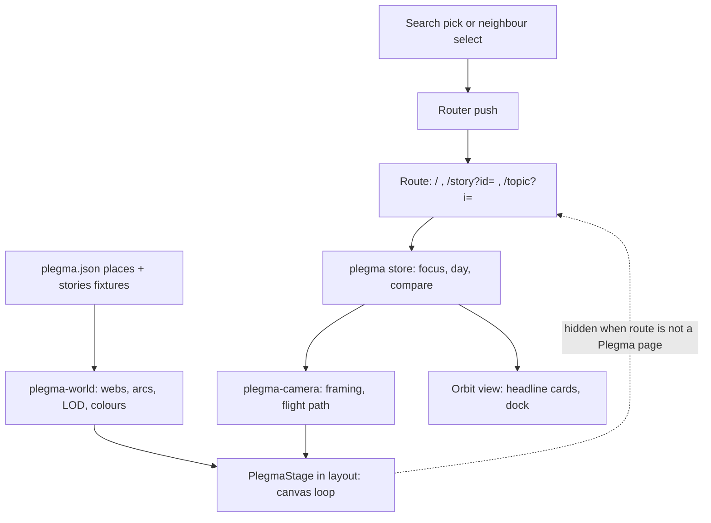

# Plegma World Map - Plan

## Goal Capsule

- **Objective:** A visitor who picks a story or theme in search is flown across one fixed map of all stories (the Plegma) to that story, and can read it, compare it, and move to related stories without leaving the map.
- **Means (fixed by the user):** The home hero field becomes the Plegma, and the story and theme chart pages become Plegma views (the first two Key Decisions).
- **Product authority:** The user's words, quoted in the Key Decisions, then the Requirements, then the Key Technical Decisions, then the units. A unit never overrides a Requirement.
- **Stop and ask when:** U1's prototype is ready for the user to judge (nothing after U1 starts before they have chosen the layout rule and approved the flight), a measurement says the map cannot hold its frame rate, a unit would change a quoted decision, or the context passes 70% (write a handoff with `ce-handoff`).
- **Who ships:** The user's session builds each phase on its own `claude/plegma-<name>` branch. Small commits, an early draft PR, a Netlify preview, the user's screenshots, merge only on the user's word (`docs/solutions/workflow/pr-and-merge-flow.md`).
- **Not active scope:** Outlet, group and person pages, the Αναλύσεις pages, phones and touch.

---

## Product Contract

*Product Contract preservation: restructured, no scope change. The Key Decisions now quote the user and gain one entry (no arcs for stories with no theme, which confirms AE2). Dependencies gain the October data finding. R4 now states the hero's existing rule that themes beyond the donut's colours stay ink, and the theme Key Decision allows the banded layout rule if the user picks it. The deferred-to-planning questions are answered by KTD2 to KTD14 and removed.*

### Summary

One Plegma, a map where every story has a permanent place. Home shows it framed on the best stories of the latest week. Picking a story or theme in search flies the camera to it: the story's web sits at the top-left and the rest of the screen is an Orbit of floating cards. From there the visitor sees which outlets pushed the story, steps through its days, compares it with another story, and follows a dashed arc to another story of the same theme. The story and theme views replace today's chart pages.

### Problem Frame

The home hero is a calm field of dots that leads nowhere, and a story or theme is reached by a plain page navigation into a stack of chart cards. The user wants the hero to be the way in: the search result is a place on the map, and related stories are neighbours on it. The 2026-11-06 click-to-zoom on a web was a starting point, not a rejection; it failed because it was a bare zoom with no cards and nothing to do there.

### Key Decisions

- **The Plegma view replaces the story and theme chart pages.** The user, asked where the view lives, chose "Replaces the detail page", having said "this propably gonna be the specific page of those". Governs R1, R2. (session-settled: user-directed — chosen over keeping the chart pages behind an "open full page" action and over a map mode on the detail page: the user wants the map to be the page.)
- **One fixed world map, not a field that re-forms around the pick.** The user chose "One fixed world map" after being told it reverses the 2026-11-06 "no fixed positions" decision. Governs R3, R4. (session-settled: user-directed — chosen over re-forming around the pick and over a hybrid.)
- **Home is that same map, framed on the best stories of the latest week.** The user answered "the best of the latest week". Governs R5. (session-settled: user-directed — chosen over keeping today's roaming field as separate decoration: one map, one mental model.)
- **Layout is Orbit with the story's web at the top-left and the cards on the rest of the screen.** The user wrote "orbit , but pleagma on the left top? and cards on other"; the question mark leaves the top-left position to be confirmed when U1 is reviewed. Governs R7, R8. (session-settled: user-directed — chosen over a map band above scrolling cards and over a map with a side sheet.)
- **The actions are the user's list plus the arc.** The user wrote "maybe all this and navigate to a story of the theme, with a visual ling maybe , like hero does now?" in answer to the outlets, days and compare examples. Governs R9 to R12. (session-settled: user-directed — chosen over a shorter action list.)
- **A story with no theme has no arcs.** The user answered "No arcs for them" when offered arcs to related stories for such stories. Governs R4, R10. (session-settled: user-directed — chosen over drawing arcs to related stories for stories with no theme: keeps theme as the only arc rule until October themes are coded.)
- **Outlets appear only inside cards, never as dots or colours on the map.** Keeps the 2026-11-06 "stories and themes, not outlets" decision. Governs R9.
- **Theme is shown as colour and arcs, not as one region per theme.** 2,453 of 7,515 stories (all from 1 October) sit in the catch-all «Άλλα», so regions would put the newest stories in one place. U1 may still show a banded layout for the coded stories, and it applies only if the user picks it. Governs R4, R10.

### Requirements

**The map**

- R1. Picking a story in search opens that story's Plegma view; the story's own address opens the same view.
- R2. Picking a theme in search opens that theme's Plegma view, showing the theme's stories as webs joined by arcs.
- R3. Every story has one permanent place on the Plegma; a story is in the same place on every visit.
- R4. A story whose theme has a colour in the Θέματα donut shows it, and any other themed story is ink; stories of one theme are joined by dashed arcs as the hero does now. A story in «Άλλα» has no arcs.
- R5. Home shows the Plegma framed on the best stories of the latest week, with webs held in place and breathing slowly.
- R6. A picked story always gets a web and a view, however few articles it has; the same story elsewhere on the map stays a loose dot below about 20 articles.

**The view of one story or theme**

- R7. The picked story's web sits at the top-left; four headline cards float around it and the remaining cards wait in a dock, opened one at a time as floating cards.
- R8. The cards of a story view cover what today's story page covers; a theme view's cards cover what today's topic page covers.
- R9. A story view lets the visitor see which outlets pushed the story. Outlets appear in cards only.
- R10. A story view lets the visitor follow a visible arc to another story of the same theme and move to it, updating the cards.
- R11. A story view lets the visitor step through the story's days and see the web and cards at that day.
- R12. A story view lets the visitor compare the story with a second story chosen by the visitor.

**The flight**

- R13. Picking from search flies the camera from the current view to the pick, and moving to a neighbour flies the same way; both leave the visitor on the map with no page load.
- R14. A story address opened cold lands on the view already settled, with no flight.
- R15. With reduced motion, the camera cuts to the target instead of flying.
- R16. The feel of the flight (camera path, arc drawing, card arrival) is settled by a throwaway prototype before the real build starts.

### Key Flows

- F1. Search to story
  - **Trigger:** The visitor picks a story in search on Home or on any page that has search.
  - **Steps:** The camera flies to the story's place; its web grows at the top-left; the headline cards arrive around it; arcs to same-theme stories draw in.
  - **Outcome:** The visitor is in the story's view and can act on R9 to R12.
  - **Covered by:** R1, R6, R7, R13
- F2. Neighbour to neighbour
  - **Trigger:** The visitor selects an arc or a related story's web.
  - **Steps:** The camera flies to that story; the cards update to it; the previous story stays on the map.
  - **Outcome:** The visitor has moved to a same-theme story without leaving the Plegma.
  - **Covered by:** R10, R13
- F3. Cold open
  - **Trigger:** The visitor opens a story or theme address directly.
  - **Outcome:** The view is settled on the story or theme; no flight plays.
  - **Covered by:** R1, R14

### Acceptance Examples

- AE1. **Covers R6.** Given a story of 6 articles from August, when the visitor picks it in search, the camera flies to it, it has a web and the full view; on Home it was a loose dot.
- AE2. **Covers R4.** Given a story from 12 October, when its view opens, the story shows no theme colour and no arcs.
- AE3. **Covers R14.** Given the address of a story pasted into a new tab, when the page loads, the view is settled and no flight plays.
- AE4. **Covers R15.** Given a visitor with reduced motion, when they pick a story, the camera cuts to it.
- AE5. **Covers R9.** Given a story view, when the visitor opens the outlets card, outlets are listed there and no outlet appears as a dot or colour on the map.

### Scope Boundaries

**Deferred for later**

- Phones, touch and keyboard use of the map; only R15 is committed here.
- Showing outlets, groups or people as places on the map.

**Outside this work**

- Outlet, group and person pages keep their current pages.
- The Αναλύσεις pages stay static pages.
- Arcs to related stories for stories with no theme (the user's decision above).

### Dependencies / Assumptions

- Home is a static page today and is not in `web/ported-pages.json`; the map has to live in the Nuxt layout to survive navigation, so porting Home belongs to this work.
- The fixtures hold counts per story, per day and per outlet, not individual articles; the dots and webs are drawn from counts, not from real articles.
- Coded themes end on 30 September 2026 in the current fixtures. The plan assumes the map works unchanged when later months get themes.
- None of the 2,453 stories from 1 October on has stance, framing or section data either (`web/public/data/storyDetail.json`: `f`, `s` and `c` are empty for all of them). The newest third of the map, and so everything Home frames, has per-day and per-outlet counts only.
- The pixel-parity rule of the Nuxt migration plan does not bind the story and theme views, as the user said for redesigned pages (`docs/prompts/2026-11-09-nuxt-app/handoff-12.md`).
- Reduced-motion behaviour of the current field is one static settled frame; R15 extends that to the flight.

---

## Planning Contract

### Context and research

- Search is already a Nuxt component: a story pick resolves to `/story?id=` and a theme to `/topic?i=` through `searchTarget` (`web/app/utils/links.ts`), and `GlobalSearch.vue` has no hero form yet. Home is the static `docs/redesign/prototypes/index.html`; `public/_redirects` ends with a non-forced `/* /200.html 200`, so a Nuxt `/` page needs `index.html` added to `ported-pages.json` so that `sync-prototype.mjs` stops copying it.
- The field is `docs/redesign/prototypes/assets/hero-field.js` (531 lines, canvas 2D): `web()` shapes a story from a seeded generator, themes take colour slots, arcs are dashed chains between a theme's stories, and a full web has `PER = 32` dots (a dot stands for several articles; a web's dot count there depends on the day's largest story). It runs on `Home.index` lookups (`byDay`, `rowsOf`) of `assets/home.js`.
- A story has `days` as day/article pairs and `outlets` as a count in `stories.json`, and per-outlet per-day rows in `storyDetail.json` (`t`, triples outlet/day/count). Related stories use title words and shared days (`relatedStories` in `web/app/utils/story-detail.ts`), so they exist for every story; stance, framing and sections (`f`, `s`, `c`) exist only before October.
- `StoryDetail.vue` (208 lines) already hides the stance and "how they write" cards for a story without profile (`labelled`). `TopicDetail.vue` is 181 lines. Theme colours in the app are `var(--cat-N)` by rank (`colorOf` in `web/app/composables/useTopics.ts`).
- Page changes use view transitions (`web/app/plugins/view-transition.client.ts`); the first frame is held until the page is drawn (`docs/solutions/design-patterns/cross-document-view-transitions-on-script-drawn-pages.md`). Colours are tokens read lazily (`docs/solutions/conventions/color-tokens-and-the-check.md`, `docs/solutions/conventions/theme-tokens-only.md`); a new class name is searched in the shared CSS first (`docs/solutions/workflow/check-class-names-against-shared-css.md`).
- Bake-off not run: the two open mechanisms (a persistent stage versus a canvas per page, canvas 2D versus WebGL) are decided by U1's measurement and are reversible inside the stage component.

### Key Technical Decisions

- KTD1. **One persistent stage in the layout, driven by the route.** The stage (canvas, camera, drawing loop) mounts once in `layouts/default.vue`; a page declares `definePageMeta({ plegma: true })`, Home, story and theme do. On any other route the stage is hidden and its loop halted, its state kept. A canvas per page would end each flight at a page change. Governs R13, R14.
- KTD2. **The route is the source of truth for what is focused.** `/story?id=` and `/topic?i=` stay the addresses (R1, R14); the `plegma` store reads focus from them, and the stage flies when focus changes. The day being stepped and the story being compared live in the store only, not in the address. Governs R1, R2, R11, R12.
- KTD3. **Canvas 2D, adapted from the hero field, with a camera, culling and levels of detail.** Far away a story draws as a soft dot, nearer as a web without lines, nearest with lines and arcs. No new graphics dependency. U1 measures it with all 7,515 stories; WebGL is considered only if frames drop during a flight at 1× CPU and the cause is drawing. Governs R5, R13.
- KTD4. **A story's place is a pure function of its own fields, and none of them can change once the story exists.** The time axis is the story's first day as an absolute offset from a fixed epoch, inside fixed world bounds that leave room to the right for later months; neither the window length nor another story's data enters it. A story's peak day is not used, because it moves while the story runs. A generator step in `sync-prototype.mjs` writes `public/data/plegma.json` (generated and git-ignored, like the other fixtures). The vertical rule is picked in U1 by the user's look from a seeded spread for every story, and a banded layout for coded stories with a seeded spread for the rest. Governs R3, R4.
- KTD5. **A web's shape is seeded by the story id,** so the same story looks the same on Home, in its view and as a neighbour. Its dot count comes from the story's own article count on a fixed square-root scale between the hero's smallest and largest web (6 to 32 dots), with the article count that maps to 32 fixed by U1, so it never depends on another story. A story below about 20 articles is a loose dot until it is focused or compared, then it gets a web of at least the smallest size at a readable zoom. Governs R6.
- KTD6. **A story's colour is the colour its theme has in the Θέματα donut for the whole window,** the ranked `--cat-N` token of the donut's offered themes (`useTopics`, the first eight non-catch-all); every other theme, and «Άλλα», stays ink as in the hero today, and an ink theme still joins its stories by arcs. Governs R4.
- KTD7. **The flight is a zoom-out-then-in camera path whose length grows with the distance;** a new pick during a flight redirects it from where the camera is. Cold open, back to a settled view and reduced motion set the camera directly. Between two Plegma routes the page view transition is skipped, because the stage animates instead. U1 sets the durations and easing, not the mechanism. Governs R13, R14, R15, R16.
- KTD8. **Cards are the existing card bodies, extracted and shared by both views,** placed in fixed slots around the map region by CSS (no dragging). Four headline slots, the rest behind dock chips, one open at a time. Defaults: story view headline = articles per day, outlets, how it was written, related stories; theme view headline = articles per day, its stories, outlets, stance. Cards with no data (no profile) are absent; the remaining headline cards fill the slots in that order, empty slots stay empty and the dock is hidden when it holds nothing. The related-stories card is the existing story-page card (title words and shared days), so it exists for every story, including those with no theme, and selecting one of its stories flies to it. The cards capture pointer events only on themselves: the map region and the gaps between cards pass them to the stage, so arcs and webs stay selectable with every card open. New CSS uses theme tokens only. Governs R7, R8, R9, R10.
- KTD9. **"Best of the latest week" is the stories with the most articles in the last seven days of `stories.dates`, generic stories excluded;** nine webs on Home, four on a phone as the hero does now. The ranking is a port of `Home.rangeInfo` and is tested against it. Governs R5.
- KTD10. **Stepping through days is a store value `day`, and the view shows the story as it was on that day:** the focused web's dots are those of days up to it, and the outlets and stance cards sum days up to it (my reading of "the web and cards at that day"; the day card marks the stepped day). The control is previous and next buttons plus a click on a bar of the articles-per-day card; it starts on the whole range, and a "whole range" button clears `day`. Governs R11.
- KTD11. **Compare picks the second story from the story entries of the search index,** draws both webs and a line between them, and shows `DiffList` rows from `diffRows` when both stories have a profile; when either has none (October), it compares articles per day and outlets only. When a second story is set, the camera fits both webs in the map region and both draw as webs at any zoom; day stepping applies to the focused story only. A "remove comparison" action on the compare card clears it. Governs R12.
- KTD12. **Home becomes `pages/index.vue`.** The hero text, search and figures sit over the stage; the calendar, day card, topics card and quick access become Vue components ported from `assets/home.js`, with pixel parity checked below the hero only. Selecting a web works anywhere on the map, Home included (my call, shown to the user in the planning synthesis and confirmed; reverses the 2026-11-06 "a click on the field does nothing" rule and is cheap to reverse). Governs R5, R10, R13.
- KTD13. **The stage is fixed to the viewport under the header on every Plegma route.** On Home the hero is a transparent window over it, and the stage fades out as the page scrolls past the hero so the sections below sit on their own background. A pick made from a scrolled Home navigates, the route change returns the page to its top, and the flight starts from Home's resting camera. Governs R5, R13.
- KTD14. **The map region is the part of the screen the cards leave free,** the top-left area; a story web and a theme's stories are both fitted into it (its size is set in U1). A theme draws arcs between its largest stories only (about 25, set in U1), chained in order of first day; its other stories are dots, so a theme of hundreds of stories stays readable at the framing of its box. Governs R2, R4, R7.

### High-Level Technical Design

*This sketch shows the shape of the mechanism. The prose above is authoritative.*

### Risks and mitigations

- **Frame rate with 7,515 stories on a canvas.** Levels of detail and culling (KTD3) plus U1's measurement before the build; WebGL is the named fallback.
- **The map looks meaningless when the layout rule uses no data the newest stories have.** U1 shows candidates on real data and the user picks (KTD4); the pure-function rule keeps any choice stable.
- **A theme holds hundreds of stories** (issue 4 has 667) spread along the whole time axis, so its box is about the whole map. KTD14 limits its arcs to the largest stories and U1 tries a large theme before the build.
- **The latest week looks plain.** Its stories have no theme, stance or related-by-theme arcs (Dependencies). Accepted by the user; the cards that exist (days, outlets) still work, and the plan adds no substitute.
- **The persistent stage and the page view transition disagree on the first frame.** KTD7 skips the view transition between Plegma routes and U9 checks a move started while scrolled, Back and Forward, and three runs of each move, as the pattern note requires.
- **Home's weight.** Home already loads the stories and story-detail fixtures; `plegma.json` adds one more file (about 7,500 places), and U6 measures that Home does not load slower than the static page.
- **Night theme and English.** Colours come from tokens read lazily and every label from message keys; U4 and U7 check both.

### Alternatives considered

- **Per-page canvas with a cross-document view transition:** rejected, a flight could not end on another page without a load.
- **Re-forming the field around the pick:** rejected by the user (Key Decisions).
- **WebGL from the start:** not chosen; it adds a dependency before a measurement shows the need.

---

## Implementation Units

| Unit | Title | Key files | Depends on |
|---|---|---|---|
| U1 | Flight and layout prototype | `docs/prompts/2026-11-10-plegma-prototype/` | none |
| U2 | World layout generator | `web/scripts/build-plegma-layout.mjs` | U1 |
| U3 | World and camera code | `web/app/utils/plegma-world.ts`, `plegma-camera.ts`, `home.ts` | U1, U2 |
| U4 | Persistent stage | `web/app/components/PlegmaStage.vue`, `web/app/stores/plegma.ts` | U3 |
| U5 | Home page and hero | `web/app/pages/index.vue`, `GlobalSearch.vue` | U4 |
| U6 | Home sections | `web/app/components/Home*.vue`, `web/app/utils/home.ts` | U5 |
| U7 | Story view | `web/app/pages/story.vue`, `web/app/components/plegma/` | U4 |
| U8 | Theme view | `web/app/pages/topic.vue` | U7 |
| U9 | Flights, arcs and navigation | `web/app/plugins/view-transition.client.ts` | U5, U7 |
| U10 | Day stepping and compare | `web/app/components/plegma/` | U7 |

### Phase A: prove the feel

### U1. Flight and layout prototype

- **Goal:** The user sees and judges the flight, the arc, the card arrival and two or three layout rules on real data, and the frame rate with every story, before anything is built on them (R16).
- **Requirements:** R16, R3, R13; decisions KTD3, KTD4, KTD7.
- **Dependencies:** none.
- **Files:** `docs/prompts/2026-11-10-plegma-prototype/prompt.md` (saved first), `docs/prompts/2026-11-10-plegma-prototype/report.md`; the prototype code stays out of `web/app/`.
- **Approach:**
  - Hand ce-prototype this question: how should the camera fly from Home's framing to a story at the top-left of an Orbit, and to a same-theme neighbour; which placement rule makes the map read well (first day across, with a banded or a seeded spread up and down); how do four headline cards arrive.
  - Also settle with the user: the size of the map region (KTD14), the article count that maps to a full 32-dot web (KTD5), the number of stories a theme draws arcs between, and the framing of a theme with hundreds of stories (issue 4 has 667) and of a compared pair that lies months apart.
  - Build on the real `stories.json` and `storyDetail.json`, with the hero's drawing code as the base, in a page of its own.
  - Measure frame time idle and during a flight at 1× and 4× CPU, against the static hero.
  - Show the user frame strips of the flight and screenshots of each layout rule, per the user's screenshot workflow, and record the choices in the report.
- **Execution note:** Throwaway. Run through ce-prototype, not ce-work.
- **Test expectation:** none -- throwaway prototype; its output is the decisions and measurements in the report.
- **Verification:** The user has chosen a layout rule and approved the flight feel and the top-left placement (or changed it); the report holds the measurements and says whether canvas 2D holds (KTD3).

### Phase B: the core

### U2. World layout generator

- **Goal:** Every non-generic story gets a stable place in a generated fixture (R3).
- **Requirements:** R3, R4; KTD4.
- **Dependencies:** U1 (the chosen rule).
- **Files:** `web/scripts/build-plegma-layout.mjs`, `web/scripts/build-plegma-layout.test.mjs`, `web/scripts/sync-prototype.mjs`.
- **Approach:**
  - A pure function from one story's fields (first day, theme, id) to a place (KTD4); the script maps it over `stories.json` and writes `public/data/plegma.json`.
  - `sync-prototype.mjs` calls it after the fixtures are converted, so `npm run dev` and `npm run generate` both produce the file.
- **Patterns to follow:** `web/scripts/build-fixtures.mjs` and its test.
- **Test scenarios:**
  - Happy path: running the generator twice gives byte-identical output.
  - Every non-generic story id in `stories.json` has a place, and no generic story has one.
  - Stability: adding a synthetic story to the input does not change any other story's place.
  - Stability: appending a later day with a larger count to a running story's days, and adding a later month to the dates, leave every place unchanged.
  - Edge: a story from October (theme «Άλλα», no profile) gets a place inside the world bounds.
  - Edge: a story with one day of articles and a story spanning 60 days both land inside the bounds.
- **Verification:** `npm test` passes; `public/data/plegma.json` appears after `npm run sync`.

### U3. World and camera code

- **Goal:** Pure, tested code for what the stage draws and where the camera goes.
- **Requirements:** R3 to R6, R13, R15; KTD3, KTD5, KTD6, KTD7, KTD9.
- **Dependencies:** U1, U2.
- **Files:** `web/app/utils/plegma-world.ts`, `web/app/utils/plegma-camera.ts`, `web/app/utils/home.ts`, `web/scripts/plegma-world.test.mjs`, `web/scripts/plegma-camera.test.mjs`, `web/scripts/home.test.mjs`.
- **Approach:**
  - Home lookups: `utils/home.ts` is the port of `Home.index`, `rangeInfo` and `outletsOf`, tested against the static `home.js` in a vm; U6 extends it with `dayInfo`, so there is one copy.
  - World: web shape from a story id seed, dots from the story's own article count (KTD5), which stories draw as webs at a camera distance, theme chains for arcs limited to a theme's largest stories (KTD14), theme colour slots, and the best-of-week list from `utils/home.ts`.
  - Camera: the framing that puts a web at the top-left map region, the framing of a theme's stories and of a compared pair inside that region, a flight path with duration, and the single-step cut.
- **Patterns to follow:** `web()`, `themataOf` and `target` in `docs/redesign/prototypes/assets/hero-field.js`; test style of `web/scripts/story-detail.test.mjs` (static code run in `node:vm`, relative `.ts` imports).
- **Test scenarios:**
  - Happy path: `web(id)` returns the same dots and edges on every call, and a different shape for another id.
  - A story of 120 articles has more dots than one of 40, a story of 3,219 articles has 32, and a story of 25 articles has more than one dot; the count depends on no other story.
  - Best of week equals the `Home.rangeInfo` ranking of the static `home.js` for the last seven days (the `home.test.mjs` vm test).
  - Covers R6. A story of 6 articles is a loose dot unfocused and a web of a few dots when focused.
  - Generic stories are absent from the best-of-week list.
  - Themed stories chain into arcs; a story in «Άλλα» is in no chain (AE2); a theme of 667 stories chains only its largest ones, in order of first day.
  - Framing: at 1440×900 the focused web's centre lands in the top-left map region; a theme framing fits all of that theme's stories inside that region; a compared pair months apart fits inside it.
  - Flight: the start and end of the path equal the two framings; the middle is zoomed out relative to both; a longer distance gives a longer duration; a flight asked during a flight starts from the current camera.
  - Covers AE4. With reduced motion the path is one step to the target.
- **Verification:** `npm test` passes.

### U4. Persistent stage

- **Goal:** The Plegma draws behind the app, survives page changes, and stops when it is not shown (R5, R13).
- **Requirements:** R3, R4, R5, R13, R15; KTD1, KTD2, KTD3, KTD6.
- **Dependencies:** U3.
- **Files:** `web/app/components/PlegmaStage.vue`, `web/app/stores/plegma.ts`, `web/app/layouts/default.vue`, `web/app/assets/css/plegma.css`, `web/nuxt.config.ts`, `web/scripts/plegma-store.test.mjs`.
- **Approach:**
  - The store holds focus (story, theme or none), day, compare and flight state; a route watcher sets focus from the page meta and query.
  - The stage draws the webs, arcs and loose dots with the hero's look (translucent tooltip with its `is-field` class, hover slows and lights a web and its theme), with levels of detail from U3.
  - It pauses when the tab is hidden or the stage is off screen, draws one still frame with reduced motion, and is hidden on a route without the `plegma` meta.
  - Every web stays at its permanent place while its dots wander a few pixels on slow waves, as `hero-field.js` does, so webs breathe; the framing may drift slowly on top (R3, R5).
  - The stage is fixed to the viewport and fades out as Home scrolls past the hero (KTD13).
  - Class names are searched in the shared CSS first; colours are tokens.
- **Patterns to follow:** `hero-field.js` (loop, visibility, `ResizeObserver`, `is-field` tooltip), `web/app/stores/tooltip.ts`.
- **Test scenarios:**
  - Store: a route `/story?id=5` sets focus to story 5; `/topic?i=3` to theme 3; `/media` to none and marks the stage hidden.
  - Store: focus changes while a flight runs redirect the flight.
  - Integration: hovering a web shows a tooltip with the story, its theme and its articles; leaving hides it and removes `is-field`.
  - Integration: the loop stops when the tab is hidden and when the route has no `plegma` meta, and resumes when shown.
  - Covers AE4. With reduced motion one still frame is drawn and nothing animates.
- **Verification:** `npm test`, `npx nuxt typecheck`; no console errors in Chrome at 1440×900 in day and night themes; frame time recorded next to U1's numbers.

### Phase C: Home

### U5. Home page and hero

- **Goal:** `/` is a Nuxt page whose hero sits over the Plegma, with the hero search and the first screen as today (R5).
- **Requirements:** R5, R13; KTD9, KTD12.
- **Dependencies:** U4.
- **Files:** `web/app/pages/index.vue`, `web/app/components/HomeHero.vue`, `web/app/components/GlobalSearch.vue`, `web/ported-pages.json`, `web/scripts/search.test.mjs`.
- **Approach:**
  - The masthead, hero search (a hero form of `GlobalSearch`, as `Shell.Search({ hero: true })`), topic chips and the figure strip are Vue, over the stage framed on the best of the latest week.
  - `ported-pages.json` gains `index.html` for `/`; `sync-prototype.mjs` then stops copying it.
  - The first frame stays held until the page is drawn (the head script of `utils/arrival.ts`).
  - A pick from a scrolled Home returns the page to its top and starts the flight from Home's resting camera (KTD13).
- **Patterns to follow:** `Hero`, `Masthead` and `Shell.Search` in `assets/home.js` and `assets/shell.js`; classes `home-hero*` of `home.css`.
- **Test scenarios:**
  - The hero search opens on click and on `/`, and a chip fills the query with its topic.
  - The figures (articles, outlets, stories, days) equal the static page's for the same window.
  - Integration: opening `/` cold prerenders the masthead and figures without the canvas, and the canvas appears after mount.
  - Integration: with Home scrolled 1,200 px, picking a story in the hero search navigates to its view at the top of the page, and the stage is visible while the sections below the hero have their own background.
- **Verification:** `npm test`, `npm run generate` builds; the first screen matches the static page's text and layout by eye; the user's screenshot of Home.

### U6. Home sections

- **Goal:** The calendar, the day card, the topics card and the quick access are Nuxt components with the static page's look.
- **Requirements:** R5; KTD12.
- **Dependencies:** U5.
- **Files:** `web/app/components/HomeCalendar.vue`, `HomeDayCard.vue`, `HomeTopicsCard.vue`, `HomeQuick.vue`, `web/app/utils/home.ts`, `web/scripts/home.test.mjs`, `web/scripts/pixel-diff.mjs`.
- **Approach:**
  - `utils/home.ts` (created in U3 with `Home.index`, `rangeInfo` and `outletsOf`) gains the port of `dayInfo`, tested against the static `home.js` in a vm.
  - The pixel check for `/` excludes the hero region (U6 adds that option to `pixel-diff.mjs`; the script's current options were not read in planning).
- **Patterns to follow:** `DayCard`, `Calendar`, `TopicsCard`, `QuickCard` in `assets/home.js`; `DailyCard.vue` for the daily chart.
- **Test scenarios:**
  - `dayInfo` and `rangeInfo` return the static code's results for 10 sampled days and three ranges.
  - Picking a day in the calendar updates the day card; the day card lists the day's stories and outlets.
  - Edge: a day with no data shows the empty state of the static page.
  - Integration: the quick-access links go to the same routes as the static page.
- **Verification:** `npm run check:pixel -- "/"` is 0 below the hero at 1440 and 390 and in the night theme; Home does not load slower than the static page (measured, recorded in the report).

### Phase D: the views

### U7. Story view

- **Goal:** A story opens as an Orbit over the Plegma with its cards, outlets and neighbours (R1, R7 to R9).
- **Requirements:** R1, R6, R7, R8, R9, AE5; KTD5, KTD8.
- **Dependencies:** U4.
- **Files:** `web/app/pages/story.vue`, `web/app/components/plegma/PlegmaStoryView.vue`, `PlegmaCard.vue`, `PlegmaDock.vue`, `web/app/components/plegma/cards/` (cards extracted from `StoryDetail.vue`), `web/app/utils/plegma-story.ts`, `web/scripts/plegma-story.test.mjs`, `web/app/assets/css/plegma.css`.
- **Approach:**
  - Extract each card body of `StoryDetail.vue` into a component, keeping its data code (`storyRows`, `reachOf`, `peopleOf`, `diffRows`), then place the four headline cards in their slots and the rest behind dock chips.
  - `utils/plegma-story.ts` decides which cards exist for a story (no profile: no stance, no how) and which are headline, in the slot order of KTD8, with the dock hidden when empty.
  - The floating card shell passes pointer events through outside the cards (KTD8).
  - Delete `StoryDetail.vue` once nothing imports it (grep first, per `docs/solutions/workflow/verify-dead-exports-before-deleting.md`).
- **Patterns to follow:** `StoryDetail.vue`, `GroupDetail.vue` and `pages/group.vue` (a `ClientOnly` body keyed by the query, `useFixtureLazy`, loading/problem/404 branches).
- **Test scenarios:**
  - A story with a profile has four headline cards and the stance and how cards in the set; a story from October has neither, three headline cards (days, outlets, related), one empty slot, and no dock.
  - A story with no theme still lists related stories, and selecting one of them flies to it.
  - Integration: with the four headline cards open, selecting an arc or a neighbour's web in the map region (Greek and English) moves to that story.
  - Covers AE5. The outlets card lists outlets and the stage receives no outlet as a dot or colour.
  - Opening a dock chip opens that card and closes the one open.
  - Edge: an id with no story shows the 404 state; the story page's `?state=empty` and `?state=error` still show their states.
  - Integration: the page title and trail show the story's name (`useDetailTitle`).
- **Verification:** `npm test`, `npx nuxt typecheck`; story views at 1440 and in night and English checked by the user's screenshots.

### U8. Theme view

- **Goal:** A theme opens as the Orbit over its stories joined by arcs (R2, R8).
- **Requirements:** R2, R4, R8; KTD8, KTD14.
- **Dependencies:** U7.
- **Files:** `web/app/pages/topic.vue`, `web/app/components/plegma/PlegmaThemeView.vue`, cards extracted from `TopicDetail.vue`, `web/app/utils/plegma-theme.ts`, `web/scripts/plegma-theme.test.mjs`.
- **Approach:** Same shell as U7; the camera frames the theme's stories (U3); the cards are the topic page's. Delete `TopicDetail.vue` after the grep.
- **Test scenarios:**
  - A theme with 12 stories frames all 12 and joins them by arcs.
  - A theme of 667 stories fits its box in the map region and draws arcs between its largest stories only.
  - Covers AE2. The theme «Άλλα» draws its stories with no arcs.
  - Edge: a theme with no story in the window shows the empty state.
  - The headline set of a theme view is the four of KTD8.
- **Verification:** `npm test`, typecheck; the user's screenshot of a theme view.

### U9. Flights, arcs and navigation

- **Goal:** Every way into a view is a flight or a cold open as the Requirements say (R10, R13 to R15).
- **Requirements:** R10, R13, R14, R15, F1 to F3, AE3, AE4; KTD2, KTD7, KTD12.
- **Dependencies:** U5, U7.
- **Files:** `web/app/plugins/view-transition.client.ts`, `web/app/components/PlegmaStage.vue`, `web/app/components/GlobalSearch.vue`, `web/app/utils/plegma-route.ts`, `web/scripts/plegma-route.test.mjs`.
- **Approach:**
  - Selecting an arc, a neighbour's web or any web on the map pushes the route; the stage flies on the focus change.
  - A story or theme address opened cold, and a Back or Forward to a settled view, set the camera directly.
  - The page view transition is skipped when both routes are Plegma pages.
- **Patterns to follow:** the `skip(transition)` and `directionOf` code in `view-transition.client.ts`; `docs/solutions/design-patterns/cross-document-view-transitions-on-script-drawn-pages.md`.
- **Test scenarios:**
  - `plegma-route` classifies a move: Plegma to Plegma is a flight; the first load is a cold open; reduced motion forces a cut.
  - Covers AE3. A cold open of `/story?id=5` shows no flight.
  - Covers AE1 and F1. Picking a story from the hero search on Home flies to it and ends on its view.
  - Covers F2. Selecting an arc moves the focus to the neighbour and updates the cards.
  - Integration: a move started while the page is scrolled, Back and Forward across the views, and three runs of each move show no skeleton frame and no morph.
- **Verification:** `npm test`; Chrome checks with CDP frames of a flight; no console errors across the moves.

### U10. Day stepping and compare

- **Goal:** The visitor steps through a story's days and compares it with a second story (R11, R12).
- **Requirements:** R11, R12; KTD10, KTD11.
- **Dependencies:** U7 (the story view and, through it, the stage and store).
- **Files:** `web/app/components/plegma/PlegmaDayStepper.vue`, `PlegmaCompare.vue`, `web/app/utils/plegma-compare.ts`, `web/scripts/plegma-compare.test.mjs`, `web/app/stores/plegma.ts`.
- **Approach:**
  - The stepper sits on the articles-per-day card with previous and next buttons, a click on a bar, and a "whole range" button (KTD10); stepping sets `day`, the web's dots filter to days up to it and the outlets and stance cards sum days up to it.
  - Compare is a dock card with a story picker over the search index and a "remove comparison" action; it draws the second web and a line, fits both in the map region, and shows the `DiffList` card when both have a profile, else days and outlets only (KTD11).
- **Patterns to follow:** `DiffList.vue`, `diffRows` and `diffScale` in `story-detail.ts`; the story entries of `utils/search.ts`.
- **Test scenarios:**
  - Covers R11. At day 5 of a 12-day story the web has the dots of days 1 to 5 and the outlets card sums days 1 to 5 only; clearing the day shows the whole range.
  - Compare of two stories with profiles gives diff rows; compare with an October story gives days and outlets only and no stance rows.
  - Edge: comparing a story with itself is refused by the picker.
  - Compare with a story months away fits both webs in the map region; "remove comparison" restores the single-story framing.
  - The whole-range button restores the full web and cards after stepping to day 5.
  - Edge: leaving the story clears `day` and compare.
- **Verification:** `npm test`, typecheck; the user's screenshots of a stepped day and of a comparison.

---

## Verification Contract

Run from `web/` unless noted.

| What | Command | Applies to |
|---|---|---|
| Unit tests | `npm test` (`node --test scripts/*.test.mjs`) | every unit with code |
| Types | `npx nuxt typecheck` (`npm run typecheck` syncs first) | every unit with code |
| Build | `npm run generate` | U2, U5, U6, U9 |
| Pixel parity | `npm run check:pixel -- "<route>"` | `/` below the hero (U6); the pages the shared code touches (`/trends`, `/stories`, `/groups`, `/media`, `/group?g=skai`) |
| Prototype checks | `node ../docs/redesign/prototypes/scripts/check.mjs` | after any change under `docs/redesign/prototypes/` |
| Frame time | the U1 measurement script, rerun in U4 and U9 | no burst of frames over 50 ms during a flight at 1× CPU; Home idle no worse than the static hero at 4× |
| Browser | Playwright with `/usr/bin/google-chrome` against `nuxt dev --port 3123` and the build: console errors, day and night, Greek and English, CDP frames of a flight | U4, U5, U7 to U10 |

The Netlify preview of each PR is checked by the user against the requirements that PR delivers; the last PR's preview covers R1 to R16.

Not checked in this plan, as in the migration reports: Safari, Firefox, widths other than 1440 and 390, and touch (each PR's report says which were done).

## Definition of Done

- Every requirement R1 to R16 is true on the Netlify preview of the last PR, and AE1 to AE5 hold.
- `npm test` and `npx nuxt typecheck` pass; `npm run generate` builds; no console error on Home, a story view, a theme view or any flight, in Greek and English.
- The pages that share code with the changed ones keep pixel parity 0; Home matches below the hero.
- The user has seen screenshots or frame strips of U1's choices, Home, a story view, a theme view, a flight, a stepped day and a comparison, and has said what to change.
- `docs/prompts/2026-11-10-plegma-*/report.md` holds the real commands and measurements; `docs/plans/2026-11-09-1742-refactor-nuxt-app-migration-plan.md` carries a note that Αναλύσεις stay static, that Home (U14) is done by this plan, and that U17's cut-over now waits on both.
- Code from attempts that did not pan out (prototype helpers, unused cards) is removed from the diff; `StoryDetail.vue` and `TopicDetail.vue` are gone only after a grep shows no importer.
- The lesson goes to `docs/solutions/` through `ce-compound` once the work is verified.

## Sources and Research

- `docs/redesign/prototypes/assets/hero-field.js`, `assets/home.js`, `assets/home.css`, `index.html`: the field and Home.
- `docs/prompts/2026-11-06-hero-field/report.md`: field decisions, the removed click-to-zoom, the themes-until-30-September limit.
- `docs/prompts/2026-11-09-nuxt-app/handoff-12.md`: Nuxt migration state, detail-page pattern, gotchas (auto-imported util constants must be prefixed per page).
- `docs/plans/2026-11-09-1742-refactor-nuxt-app-migration-plan.md`: U14 (Home) and the pixel rule.
- `web/app/components/StoryDetail.vue`, `TopicDetail.vue`, `GlobalSearch.vue`; `web/app/utils/links.ts`, `search.ts`, `story-detail.ts`; `web/app/composables/useTopics.ts`; `web/app/plugins/view-transition.client.ts`; `web/scripts/sync-prototype.mjs`.
- `web/public/data/stories.json`, `storyDetail.json`: 7,515 stories, median 6 articles, 1,277 with 20 or more; 2,453 starting on or after 1 October with theme «Άλλα» and no stance, framing or section data.
- `docs/solutions/`: `design-patterns/cross-document-view-transitions-on-script-drawn-pages.md`, `conventions/color-tokens-and-the-check.md`, `conventions/theme-tokens-only.md`, `workflow/check-class-names-against-shared-css.md`, `workflow/verify-dead-exports-before-deleting.md`, `workflow/plan-decisions-quote-the-user.md`, `workflow/pr-and-merge-flow.md`.
