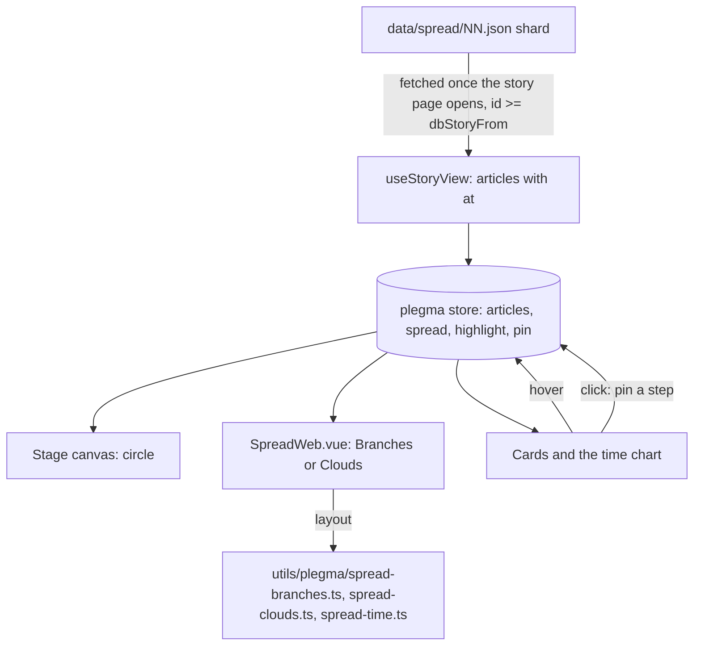

# How a story spreads, tabs on the story page and a chart that lights the dots - Plan

Target repo: `apotypos-demo-redesign`. Epic #221 with #215 to #220. #222 (zoom) is outside this plan. Branch `claude/story-spread`, small commits.

## Changed 2026-11-26 (owner): no circle on a story with article times

This section wins over everything below it. The rest of the plan is not yet rewritten to match.

Owner's choices, 2026-11-26:
- The switch sits **on the left of the map cell**, not at the top right. Order: **Κλαδιά (default), Σύννεφα**.
- "we have to drop the circle entirely from this page": **Κύκλος is not in the switch.** On a story with times, the ring tabs Μέσα / Όμιλοι / Στάση go too (they only recoloured the circle). A story without times keeps the circle (see the last point).
- The zoom of #222 is built on Κλαδιά after this plan: option **M**. A mouse notch glides one level (1, 2.4, 5). A trackpad or a pinch zooms smoothly, then settles on the next level in the direction it went. The point under the pointer stays where it is, and the cards stay. Each article has one label; the first of a group reads "Outlet · date · +N μ.". Mock: `docs/prompts/2026-11-26-plegma-zoom/mock/`.
- Branch: `claude/story-branches` from `main` (the story-page layout was merged as `9dbd13a`).

What this replaces, and my reading of what follows from it (not the owner's words):
- Replaced: Key Decision "The circle stays the default", and R5, R6's "opening starts on the circle", R7, R14 (opens from the circle), A3, KTD8 (`spread` defaults to 'branches'; there is no 'circle' tab). R7 now reads: a story without times looks the same as before.
- My reading: with no circle, the templates are the page's web and **no longer temporary**, so R8 (built to be removed) and the Key Decision "temporary" lapse.
- My reading: the dot that arrives from a theme (20 Nov transitions, "the dot is the story") becomes the start node of Κλαδιά, and the branches unfold from it.
- **Settled later the same day (owner):** "lets just keep the circle for the non article dates". A story with article times (October, 14–27 Oct) has Κλαδιά and Σύννεφα and no circle. A story with no times (August, September) keeps the circle as today, with its ring tabs and no switch. So R4 and R6 stand. August and September are not dropped. Reasons: the Aug–Sep times exist only in the Mac crawl database, which nobody here can reach; the AWS box, the colleague's VM and `old_corpus.tar` do not have them; and October stories have no stance, frames or people (the LLM tagging covered Aug–Sep only).

- **Settled again, 26 Nov evening (owner), and this wins over the point above:** August and September are dropped from the whole app; only 14–27 Oct stays (PR #223, merged). Every story has article times, so **no story page has the circle**: Κλαδιά (default) and Σύννεφα only. R4, R6 and the "story without times" branches of R7 no longer apply. Owner: "dont consider that we loose stance for now".

## Goal Capsule

- **Objective:** A reader of an October story sees how it spread in time and which outlet started it first, while the circle web they know stays as it is.
- **Means:** two temporary tabs beside the circle, drawn by one removable component from per-article publish times (KTD1, KTD4), and a click in the time chart that lights its dots (KTD5).
- **Authority:** the owner's quoted words in the epic win over the issue author's readings. Where an issue says "my reading" or "ask the owner", this plan takes the issue's default and lists it under Assumptions.
- **Stop conditions:** a settled decision cannot work, or a unit would change how the circle looks. Both stop the work and go back to the owner.
- **Who finishes:** the shipping step opens the pull request. The owner reviews screenshots and merges (`docs/solutions/workflow/pr-and-merge-flow.md`).

---

## Product Contract

### Summary

The story page gets a switch at its top right: Circle (today's web, the default), Branches, Clouds. Branches and Clouds lay the articles of the story along time, with the article that started the story at the left. A click on a step of the time chart brings that step's dots forward on every tab. The chart step fits the story, and the chart card can show bars by group or outlet. The templates are for the owner to judge and are removed later.

### Problem Frame

A story today has counts per outlet and day only, so the page cannot say who published first or how a burst unfolded within a day. The owner asked to spread the circle by date (round 1 of the mocks, rejected: lanes, stacks of dots, dots that draw bars) and chose two mocks, H (Branches) and I (Clouds), to try as tabs. October stories have the data (38,328 articles, 2,453 stories); August and September have none.

### Requirements

**Article times (#215)**

- R1. An October story page knows the outlet and the publish minute of each of its articles, read from a fixture that is split by story id and fetched only when that story's page opens.
- R2. For every story, the counts per outlet and Athens day in the fixture equal those in `storyDetail`. The list of articles keeps the story's article count.
- R3. "First" means first by publish time (first seen by the crawler when a time is missing), the page says so, and times show in Athens time.
- R4. A story of August or September reads no new file and looks as it does today. It shows no times, never zeros.

**Tabs and the circle (#216)**

- R5. A switch of three sits at the top right of the story page: Circle, Branches, Clouds. Circle is the default. It uses the app's rectangular `SegmentedControl` with the look of `.orbit-ring-tabs`.
- R6. The switch shows only when the story has times. Opening another story starts on the circle.
- R7. On the Circle tab the page is the same as before in a screenshot at 1440 and 1920.
- R8. The templates are one component, one store field, one block in `PlegmaStoryView.vue` and one CSS block. Removing them leaves today's page.
- R9. On a template tab the stage's web is hidden and the stage answers no pointer over it. Leaving the page keeps its order: the view leaves first, then the route changes. A flight to another story shows the stage again.

**Templates (#217, #218)**

- R10. Each dot is one article, in the real group color, node size and name type of the stage. The article that started the story is the dark node at the left with «Ξεκίνησε», its outlet, date and time.
- R11. Branches: one loose branch per group grows to the right with time, the group name and its share at its end. The first articles of the first groups carry the outlet and the lag. Ticks are hours while the story fits in a day, dates after. Lines follow the rule of today's web: the nearest earlier article of the same group, the first of a group from the start node.
- R12. Clouds: each wave is a loose web of its articles on one thread, its date or hours under it. The unit is a day for a story of 5 dates or more, else the smallest of 5 min, 10 min, 30 min, 1 h, 3 h, 6 h that gives 9 clouds or fewer, else a day. The caption names the unit.
- R13. On the five sample stories (8723, 8236, 7765, 8234, 7851) at 1440 and 1920, no dot lies over another or outside the area and no name lies over a dot or a name.
- R14. A template opens from the circle (nodes move from their places on the disc, early articles first, names last) and goes back the same way. Nodes drift slowly as in the web. Reduced motion shows no movement.
- R15. A tooltip on a dot gives outlet, group, date and time, and the lag after the first article, with the headline when the sample has it. A group, outlet or time lit from a card or the chart lights its dots here too.

**Chart (#219, #220)**

- R16. A click on a step of the time chart (a day or an hour) brings its dots forward on all three tabs, on stories of every month, and marks the step in the chart. A second click or Escape clears it. Arrow keys move and Enter picks.
- R17. A pick stays when the pointer leaves a ring arc or a card row. Hover lights above it and falls back to it.
- R18. With times, the chart step is the smallest of 10 min, 30 min, 1 h, 1 day that gives 96 steps or fewer from the first to the last article, and the axis begins where the story begins. Without times it stays daily.
- R19. The chart card has a switch of three: line (default, as now), by group, by outlet. The bars are one column per step, stacked in the color of the group, and their sums equal the line. A click on a column picks its step, a click on a part picks that group or outlet at that step.
- R20. Other pages that use `LinesChart` and `DayBars` look and behave as before.

### Key Decisions

Each decision carries the owner's words from the epic body of #221 (the section "Decided by the owner (2026-11-25)" and the issue texts), quoted from there.

- **The circle stays the default and is not changed.** (session-settled: user-directed — chosen over replacing the circle: owner, "in the top right tabs we have to have the circle as default we have now".) Governs R5, R7.
- **A dot is an article and the reader gets who started first.** (session-settled: user-directed — chosen over a dot per outlet and over first-seen-by-the-crawler: epic, "For these templates a dot is an article. The reader gets who started the story first".) Governs R3, R10.
- **Outlets may be dots on the map.** (session-settled: user-directed — chosen over keeping rule AE5 "outlets in cards only": epic, "the rule … AE5, is dropped".) Governs R10, R11.
- **No lanes, stacks of dots, dots that draw bars, or a circle for this spread.** (session-settled: user-directed — chosen over those layouts: owner, "forget bar chart it confused" and "not a circle, to spread by date".) Governs R11, R12, R19. Bars of R19 live only in the chart card.
- **The two templates are temporary.** (session-settled: user-directed — chosen over a permanent integration: owner, "they will be removed in the future".) Governs R8.

### Scope Boundaries

- Not built: #222, the zoom. The issue requires options mocked and picked by the owner first, and it touches the 2026-11-06 and 2026-11-20 zoom decisions.
- Not built: bars made of dots in the web, lanes, stacks (rejected above).
- Considered and not built: a regional-to-national flow view (the demo's 26 outlets have no regional sites), a separate fixture of headlines (the sample in `mme.json` stays the only headline source), a retry or offline state for the shard fetch (the circle is already there and the tabs only appear when the shard arrives).
- Deferred to Follow-Up Work: removing the templates, and moving the pinned highlight to other Plegma pages, after the owner picks.

### Open Questions

None block the work. Greek tab names, the reading of "optimize" in #219, the switch of #220, and the weak points of the mocks are listed under Assumptions and Risks with the default taken.

---

## Planning Contract

### Key Technical Decisions

- KTD1. **The templates are an SVG component over the map cell, not new canvas drawing in the stage.** One file (`SpreadWeb.vue`) holds the markup, so removal is one deletion. The mocks were SVG and passed on 740 dots. The stage's article drawing is skipped while the tab is not Circle. Alternative: draw in `stage-articles.ts`. It adds to files of about 400 lines each and spreads the removal over the stage.
- KTD2. **Each layout is a pure function in `web/app/utils/plegma/`** (`spread-time.ts`, `spread-branches.ts`, `spread-clouds.ts`): articles with times and an area in, dot places, lines, names and ticks out. The component only draws them. This is what the tests of R13 run on, and it follows the existing split (`plegma-articles.ts`, `plegma-clouds.ts`).
- KTD3. **Times join the articles without reordering the circle's list.** `PlegmaArticle` gets an optional `at` (UTC minute). Within each (outlet, day) the articles take the sorted times in turn, so the list keeps its order (day, outlet) and every circle node keeps its place and its headline. The templates sort their own copy by time. This differs from the #219 note that the list becomes time-ordered and the circle's nodes move inside their day: that would break R7 and the first Key Decision.
- KTD4. **The fixture is sharded by story id and read lazily.** The generator `docs/redesign/prototypes/scripts/make-spread-fixtures.py` writes `docs/redesign/prototypes/data/spread/<NN>.json` (NN = id modulo 50). Per story it stores, in time order, an outlet index into `storyDetail.outlets` and the UTC minute of publication (delta-coded), no headlines. It reuses the chain rules of `make-db-fixtures.py` (loaded with `importlib`, the file name has hyphens) so ids match `stories.js`, and asserts each name equals the one in `stories.js`. `sync-prototype.mjs` already copies `data/` recursively, and `build-fixtures.mjs` reads only top-level `.js`, so the shards reach `public/data/spread/` untouched. `useStoryView` fetches a shard only when `id >= dbStoryFrom` (7448).
- KTD5. **A pick is kept apart from hover.** The store keeps `highlight` (hover, as today) and a new `pin`; the stage and the templates read `highlight ?? pin`. `PlegmaHighlight` gains an optional range (minutes, or day indexes when the story has no times). The `matchNodes` cache key in `stage-articles.ts` includes the range. A node standing for several articles (stories over 250) comes forward when one of them is in the range. Alternative: reuse `highlight` for the pick, which `ringLit` in `stage-pointer.ts` clears on every pointer move.
- KTD6. **The chart step is a pure function** (`spread-time.ts`, R18). `LinesChart` and `DayBars` take opt-in props for a pick and for step labels; without them they render as today (R20).
- KTD7. **Dates and clock times format through `Intl.DateTimeFormat` with `Europe/Athens`.** Summer time ends on 25 October inside the data, so a fixed offset is wrong (the mock used one).
- KTD8. **The tab lives in the store as `spread` ('circle' | 'branches' | 'clouds'), reset to 'circle' in `syncRoute` where `ring` resets.** This is the one store field of R8. The pin of KTD5 is not temporary and is a separate field.
- KTD9. **The opening motion is eased in the component.** Start places come from `articleWebOf` on the unit disc scaled to the map cell. They are close to, not equal to, the stage's drifting disc; the stage canvas fades as the SVG appears. Under reduced motion the component cuts.

### High-Level Technical Design

Which highlight wins on screen:

| Hover (`highlight`) | Pin | Shown |
|---|---|---|
| none | none | nothing lit |
| none | a step | the pinned step |
| a group or outlet | a step | the hovered group or outlet, over the pin |
| a group or outlet | none | the hovered one |

The unit of motion: progress `p` goes from 0 (the circle's places) to 1 (the template's places). A dot's own progress is delayed by its rank in time, so early articles move first and names appear last.

### Assumptions

- A1. Tab names are «Κύκλος», «Κλαδιά», «Σύννεφα» (the issue's proposal; the owner was not asked). They live in `messages-spread.js`, so a rename is one line each in Greek and English.
- A2. #219's "optimize" means the step rule of R18. #220 means the three-way switch of R19. Both are the issue author's readings; the screenshots in the pull request are how the owner confirms them.
- A3. The title card of a long name (story 7765) reaches the right edge at 1440. The switch goes on the row of the ring tabs, over the map cell, not beside the title. The screenshot shows it.
- A4. Branches may read as bands for the 740-article story (7851). The first build keeps the mock's layout and the screenshot goes to the owner with this named.
- A5. The epic says no compound-engineering loop, and merge only on "lets merge". This run follows the owner's call of `lfg` for the loop, and leaves merging to the owner.
- A6. The sector test is stale: the rings start at `RING_START` = π (the bottom edge), so the arcs run from π up to 3π, while the test reads angles in [0, 2π). It is not a defect of `buildSectorWeb`.

### Risks

| Risk | Plan |
|---|---|
| The circle changes by accident when the stage skips drawing or the list gets times | KTD3 keeps the list order. U6 proves parity with the canvas pixels against a build of `main` (`docs/solutions/workflow/prove-a-canvas-refactor-with-the-canvas-pixels.md`) |
| A tooltip over nothing on a template tab (#187) | U6 stops the pointer paths of `stage-pointer.ts` while the tab is not Circle; `npm run check:pointer` covers it |
| A pick is cleared by the hover paths | KTD5 and a store test for pick, second pick, clear |
| 8234 has 140 of 157 articles on one day | The step rule gives it hourly steps; Clouds uses minutes or hours for it by R12 |
| The shard fetch fails | The circle is already drawn; the switch stays hidden until the shard is read |
| The epic's 5 failing tests hide new failures | The count after U1 is the baseline (Verification Contract) |

### Sources and research

- Issues #215 to #222 (`gh issue view <n> --json title,body`; plain `gh issue view` fails on Projects classic).
- Local mocks, untracked: `docs/prompts/2026-11-25-story-analytics-plegma/` (`mock2.mjs` has the H and I layouts, `chains.py` the chain check, `screenshots/`). A missing mock is not a blocker; the requirements govern.
- Code read: `web/app/components/plegma/PlegmaStoryView.vue`, `PlegmaDaysCard.vue`, `web/app/stores/plegma.ts`, `web/app/composables/useStoryView.ts`, `web/app/utils/plegma/plegma-articles.ts`, `web/app/utils/plegma/stage/stage-articles.ts`, `stage-pointer.ts`, `stage-draw.ts`, `web/app/components/charts/LinesChart.vue`, `DayBars.vue`, `docs/redesign/prototypes/scripts/make-db-fixtures.py`, `web/scripts/sync-prototype.mjs`.
- Learnings applied: `docs/solutions/conventions/match-existing-type-and-controls.md` (type sizes and controls from the app), `docs/solutions/workflow/prove-a-canvas-refactor-with-the-canvas-pixels.md`, `docs/solutions/workflow/plan-decisions-quote-the-user.md` (why the Key Decisions above quote the owner).

---

## Implementation Units

| Unit | Title | Key files | Depends on |
|---|---|---|---|
| U1 | Fix the stale sector test | `web/scripts/plegma-articles.test.mjs` | none |
| U2 | Article-times generator and shards | `docs/redesign/prototypes/scripts/make-spread-fixtures.py`, `docs/redesign/prototypes/data/spread/` | none |
| U3 | Times in the story view | `web/app/composables/useStoryView.ts`, `web/app/utils/plegma/plegma-articles.ts`, `web/app/utils/plegma/spread-time.ts` | U2 |
| U4 | Step rule, range highlight, pin | `web/app/utils/plegma/spread-time.ts`, `web/app/stores/plegma.ts`, `web/app/utils/plegma/stage/stage-articles.ts` | U3 |
| U5 | Click in the line chart | `web/app/components/charts/LinesChart.vue`, `web/app/components/plegma/PlegmaDaysCard.vue` | U4 |
| U6 | Tabs and the template shell | `web/app/components/plegma/PlegmaStoryView.vue`, `web/app/components/plegma/SpreadWeb.vue`, `web/app/stores/plegma.ts`, `web/app/utils/plegma/stage/stage-pointer.ts` | U3 |
| U7 | Branches | `web/app/utils/plegma/spread-branches.ts`, `web/app/components/plegma/SpreadWeb.vue` | U6 |
| U8 | Clouds | `web/app/utils/plegma/spread-clouds.ts`, `web/app/components/plegma/SpreadWeb.vue` | U6 |
| U9 | Opening and closing motion | `web/app/components/plegma/SpreadWeb.vue`, `web/app/utils/plegma/spread-time.ts` | U7, U8 |
| U10 | Bars by group or outlet | `web/app/components/charts/DayBars.vue`, `web/app/components/plegma/PlegmaDaysCard.vue` | U4, U5 |

### U1. Fix the stale sector test

- **Goal:** `npm test` fails on main only for the 4 tab-slide tests, so a later failure in `plegma-articles.test.mjs` means something.
- **Requirements:** A6.
- **Dependencies:** none.
- **Files:** `web/scripts/plegma-articles.test.mjs`.
- **Approach:**
  1. Read angles modulo 2π and compare with each sector start also taken modulo 2π (the sector may pass the top).
  2. Change no code under `web/app/`.
  3. Leave the 4 tab-slide tests alone.
- **Test scenarios:**
  - The test "with the groups known each node is inside the sector of its group…" passes for the seed 9 web of 120 nodes and three groups.
  - The other 6 tests of the file still pass.
- **Verification:** `npm test` shows 4 failing tests, all about tab slides.

### U2. Article-times generator and shards

- **Goal:** the times of every October article exist as small id-sharded files.
- **Requirements:** R1, R2, R3, R4. KTD4.
- **Dependencies:** none. Needs the local October database (container `apotypos-scratch-pg`, read-only).
- **Files:** `docs/redesign/prototypes/scripts/make-spread-fixtures.py`, `docs/redesign/prototypes/data/spread/00.json` to `49.json`, `web/scripts/spread-fixture.test.mjs`.
- **Approach:**
  1. Start from `docs/prompts/2026-11-25-story-analytics-plegma/chains.py` and the chain rules of `make-db-fixtures.py`. Assert each rebuilt name equals the `stories.js` name for its id.
  2. Per article keep the outlet index into `storyDetail.outlets` and the minute of `published_at`; use `first_seen_at` when it is missing (1 article).
  3. Write shards by id modulo 50, articles in time order, delta-coded. No headlines, no database password or service role in the file or the script.
  4. The usage line and the docstring follow `make-db-fixtures.py`.
- **Test scenarios:**
  - For every story id in the shards, the counts per (outlet, Athens day) equal the counts of `storyDetail` row `t` triples (R2).
  - The sum of articles of each story equals the `n` of the story in `stories.json`.
  - No shard has a story with id below `dbStoryFrom`.
  - The shards total about 356 KB before gzip; the test fails above 600 KB.
- **Verification:** the generator runs twice with the same output; the test passes on `public/data/` after `npm run sync`.

### U3. Times in the story view

- **Goal:** `useStoryView` gives each article its time when the story has a shard, and nothing changes otherwise.
- **Requirements:** R1, R3, R4. KTD3, KTD4, KTD7.
- **Dependencies:** U2.
- **Files:** `web/app/composables/useStoryView.ts`, `web/app/utils/plegma/plegma-articles.ts`, `web/app/utils/plegma/spread-time.ts`, `web/scripts/spread-time.test.mjs`, `web/scripts/plegma-articles.test.mjs`.
- **Approach:**
  1. Add `at?: number` to `PlegmaArticle`.
  2. Fetch `/data/spread/<NN>.json` lazily, like the `mme` fixture, only when `id >= dbStoryFrom`. A failed fetch leaves the page as it is.
  3. Give times to the articles of each (outlet, day) in sorted order (KTD3). A pure helper does the join and is tested.
  4. `spread-time.ts` holds the Athens formatters (KTD7) and the first-by-publish-time rule.
  5. Expose `hasTimes` on the view for U6.
- **Patterns to follow:** the `mme` lazy fixture in `useStoryView.ts`.
- **Test scenarios:**
  - The join keeps list length and order for a story with two outlets over two days.
  - An article's day computed from its `at` in Athens time equals its `day` index, across 25 October (summer time ends) .
  - A story id below `dbStoryFrom` gives no fetch and no `at`.
  - The first article is the earliest `at`, and a story with a missing `published_at` uses first-seen.
- **Verification:** the circle of 7765 at 1440 is the same as before (settled-DOM or canvas comparison of U6).

### U4. Step rule, range highlight, pin

- **Goal:** the pure and store parts of "click a step lights its dots".
- **Requirements:** R16, R17, R18. KTD5, KTD6.
- **Dependencies:** U3.
- **Files:** `web/app/utils/plegma/spread-time.ts`, `web/app/utils/plegma/plegma-articles.ts`, `web/app/stores/plegma.ts`, `web/app/utils/plegma/stage/stage-articles.ts`, `web/app/utils/plegma/stage/stage-draw.ts`, `web/scripts/spread-time.test.mjs`, `web/scripts/plegma-store.test.mjs`, `web/scripts/plegma-articles.test.mjs`.
- **Approach:**
  1. `chartStep(first, last)` returns the smallest of 10 min, 30 min, 1 h, 1 day with at most 96 steps.
  2. Extend `PlegmaHighlight` with a range and `matchesHighlight` with it (days when `at` is missing).
  3. Add `pin`, `setPin`, and the effective highlight to the store. Clear `pin` where `highlight` clears in `syncRoute`.
  4. `stage-articles.ts` and `stage-draw.ts` read the effective highlight; the `matchNodes` key includes the range.
- **Test scenarios:**
  - `chartStep`: 8236 and 8723 spans give 10 min, 8234 gives 1 h, 7765 and 7851 give 1 day, a 3-minute story gives 10 min.
  - `matchesHighlight` with a range and a group matches an article only when both hold; with a range alone it matches by time.
  - `matchNodes` for a story of 500 articles lights a node when one of its two articles is in the range.
  - Store: pick, second pick of the same step clears, a hover over it wins and falls back to the pin on leave, a new focus clears the pin.
- **Verification:** `npm test` and `npm run typecheck` pass with no new failure.

### U5. Click in the line chart

- **Goal:** the chart card picks a step and the dots come forward.
- **Requirements:** R16, R17, R18, R20. A2.
- **Dependencies:** U4.
- **Files:** `web/app/components/charts/LinesChart.vue`, `web/app/components/plegma/PlegmaDaysCard.vue`, `docs/redesign/prototypes/assets/messages-spread.js`.
- **Approach:**
  1. `LinesChart` gets opt-in props for the picked index, step labels and a `pick` event; with none of them it renders as today.
  2. `PlegmaDaysCard` builds the series by `chartStep` when the story has times and by day otherwise, and sets the pin.
  3. Keyboard: arrows move, Enter picks, Escape clears. The picked step is marked in the chart with an app token color.
  4. Texts in Greek and English in the message file.
- **Test scenarios:**
  - Covers R16. Click on the 16 October step of 8234 (hourly) pins that hour; its dots are lit on the circle.
  - A second click on the same step, and Escape, clear the pin.
  - Arrow Right then Enter picks the next step.
  - A story of August picks days and lights the dots of that day.
  - Theme, outlet, group and trends pages render the same chart as before (R20).
- **Verification:** screenshots of 8234 and 7765 with a pick on each tab (the template tabs follow once U7 and U8 exist), at 1440 and 1920.

### U6. Tabs and the template shell

- **Goal:** the switch, the store field, and an empty `SpreadWeb` that hides the stage's web and is silent to the pointer.
- **Requirements:** R5, R6, R7, R8, R9. KTD1, KTD8.
- **Dependencies:** U3.
- **Files:** `web/app/components/plegma/PlegmaStoryView.vue`, `web/app/components/plegma/SpreadWeb.vue`, `web/app/stores/plegma.ts`, `web/app/utils/plegma/stage/stage-pointer.ts`, `web/app/utils/plegma/stage/stage-articles.ts`, `web/app/assets/css/plegma.css`, `docs/redesign/prototypes/assets/messages-spread.js`, `web/scripts/plegma-store.test.mjs`.
- **Approach:**
  1. Store `spread`, `setSpread`, reset in `syncRoute` next to `ring`.
  2. One block in `PlegmaStoryView.vue`: the `SegmentedControl` (class of `.orbit-ring-tabs`), `v-if` the story `hasTimes`, and `<SpreadWeb v-if>` in the map cell. The `ring` switch stays on Circle only.
  3. While `spread !== 'circle'` the stage skips `drawArticles`, `ringAt` and `articleAt`; `leave()` paths in `stage-pointer.ts` clear hover state.
  4. `SpreadWeb` fades with `plegma.leaving` so the leave order holds.
  5. Place the switch where A3 says; one CSS block, app type sizes only.
- **Test scenarios:**
  - Covers R6. Store: `spread` is 'circle' after `syncRoute` to another story and after a flight.
  - A story without times shows no switch and no `SpreadWeb`.
  - With the tab on Branches, the stage tooltip never shows for a pointer over the map cell (browser: `npm run check:pointer`).
  - Covers R7. Canvas pixels of the circle of 7765 and 8723 at reduced motion equal a build of `main`.
- **Verification:** `npm run check:stage` against the `main` baseline passes with zero difference; screenshot at 1440 and 1920 shows no overflow at 1920, 1440, 1100.

### U7. Branches

- **Goal:** template H on the real page.
- **Requirements:** R10, R11, R13, R15. KTD2, KTD7. Decision 3 (AE5 dropped).
- **Dependencies:** U6.
- **Files:** `web/app/utils/plegma/spread-branches.ts`, `web/app/components/plegma/SpreadWeb.vue`, `web/scripts/spread-branches.test.mjs`, `web/app/components/plegma/PlegmaOutletsCard.vue`, `docs/plans/2026-11-10-1628-feat-plegma-world-map-plan.md`.
- **Approach:**
  1. Port the H layout of `mock2.mjs` into the pure function: x is half clock, half order; branches fan out, the largest group near the middle; dots relax until none is nearer than twice its radius; lines by the rule of R11; names placed only where they meet nothing.
  2. Colors from `--cat-N` by group through the same slot function the stage uses; names in the stage's type.
  3. Ticks: hours while most of the story is inside a day, dates after; the caption says which.
  4. Tooltip with the app's tooltip store; lit nodes from the effective highlight.
  5. Update the comment at the top of `PlegmaOutletsCard.vue` and the AE5 line of the world-map plan to say AE5 was dropped on 2026-11-25.
- **Test scenarios:**
  - For each of the five sample stories as fixtures, no two dots are closer than twice their radius, none lies outside the area, no name box meets a dot or another name.
  - The start node is the earliest article and sits at the left.
  - The first article of each group is joined to the start node; every other line goes to an earlier article of its group.
  - A one-article story and a story of one group lay out without error.
  - A story of 740 articles lays out within the time budget of a frame (under 50 ms measured in the test).
- **Verification:** screenshots of the five stories at 1440 and 1920 sent with the pull request, with A4 named.

### U8. Clouds

- **Goal:** template I on the real page.
- **Requirements:** R10, R12, R13, R15. KTD2.
- **Dependencies:** U6.
- **Files:** `web/app/utils/plegma/spread-clouds.ts`, `web/app/components/plegma/SpreadWeb.vue`, `web/scripts/spread-clouds.test.mjs`.
- **Approach:**
  1. Port the I layout of `mock2.mjs`: the unit rule of R12, clouds on one thread, groups side by side inside a cloud, an uneven outline.
  2. Cloud labels name a day or a range; two ranges that would touch are merged or one is dropped, so no label lies over a label.
  3. Share the start node, colors, tooltip and highlight code with U7 through `SpreadWeb`.
- **Test scenarios:**
  - The unit rule: 8723 and 8236 give minutes or hours, 8234 hours, 7765 and 7851 days; a story of 5 dates always gives days.
  - Never more than 9 clouds unless the unit is a day.
  - On the five samples: no dot over a dot, none outside the area, no label over a label or a dot.
  - Covers R12. The caption names the unit in Greek and English.
- **Verification:** screenshots of the five stories at 1440 and 1920 with the weak points of the issue named (large clouds read as circles, a small story is beads).

### U9. Opening and closing motion

- **Goal:** the templates open from the circle and go back, and drift.
- **Requirements:** R14. KTD9.
- **Dependencies:** U7, U8.
- **Files:** `web/app/components/plegma/SpreadWeb.vue`, `web/app/utils/plegma/spread-time.ts`, `web/scripts/spread-time.test.mjs`.
- **Approach:**
  1. A pure `openProgress(rank, p)` gives each dot its delayed progress (early first); names and lines fade in last. Lines fade old out, new in, so the rough first frames are not seen.
  2. Start places from `articleWebOf` on the map cell. The stage canvas fades as the SVG appears and back.
  3. Slow drift by the stage's small circles; none under reduced motion, and the component cuts instead of easing.
- **Test scenarios:**
  - `openProgress` is 0 at p=0, 1 at p=1 for every rank, and the earliest rank is never behind a later one.
  - Under reduced motion the first frame after a tab change is the final layout (browser check).
  - Switching Circle, Branches, Circle returns the stage's web, with no console error.
- **Verification:** a screen recording or frame set of the opening for 8234, sent with the pull request.

### U10. Bars by group or outlet

- **Goal:** the chart card shows bars on request.
- **Requirements:** R19, R20.
- **Dependencies:** U4, U5.
- **Files:** `web/app/components/charts/DayBars.vue`, `web/app/components/plegma/PlegmaDaysCard.vue`, `docs/redesign/prototypes/assets/messages-spread.js`, `web/scripts/spread-time.test.mjs`.
- **Approach:**
  1. A `SegmentedControl` of line, by group, by outlet in the card head; line is the default.
  2. `DayBars` takes the same steps and the pick; its bar width cap of 8 px stays for its other users, and a prop widens it on this card.
  3. Parts keep a 1 px gap and are named in the white tooltip card, largest first, no expansion.
  4. A click on a column picks its step; a click on a part pins that group or outlet at that step.
- **Test scenarios:**
  - For 8234, 7765 and 8723 the sum of the parts of each column equals the line value of the same step, by group and by outlet.
  - A click on a part of 7765 pins `{ group, outlet?, range }` and lights only those dots.
  - Media, outlet and group pages that use `DayBars` render as before.
- **Verification:** screenshots of the three stories in the three modes at 1440 and 1920.

---

## Verification Contract

| Check | Command (in `web/`) | Expect |
|---|---|---|
| Unit tests | `npm run sync && npm test` | only the 4 tab-slide failures of `main`; every new test passes |
| Types | `npm run typecheck` | no error |
| Shards | `python3 -I ../docs/redesign/prototypes/scripts/make-spread-fixtures.py <args as its docstring>` then `npm test` | counts equal `storyDetail` for all stories |
| Circle unchanged | `npm run generate`, then `npm run check:stage -- --out <dir> --baseline <dir> --root <main worktree>/web/.output/public` | zero pixel difference on the circle scenes |
| No tooltip over a template | `npm run check:pointer` | no tooltip from the stage on Branches or Clouds |
| Look | Playwright screenshots of 8723, 8236, 7765, 8234, 7851 at 1440 and 1920 on each tab, with and without a pick | none of R13 broken; no overflow at 1920, 1440, 1100; no console error |

The main baseline is a worktree of `main` with `node_modules` linked, as in the learning cited under Risks.

## Definition of Done

- All R1 to R20 hold and every unit's verification passed.
- `npm test` shows no failure beyond the 4 of `main`; `npm run typecheck` is clean.
- The circle is pixel-identical to `main` at reduced motion.
- Removing `SpreadWeb.vue`, the `spread` field, its block in `PlegmaStoryView.vue` and its CSS leaves a working page (checked by reading the diff, not by deleting).
- No dead experiment code remains: no mock script, scratch path, or unused export is in the diff.
- The pull request body lists Assumptions A1 to A4, links the screenshots, and says #222 was not built.
